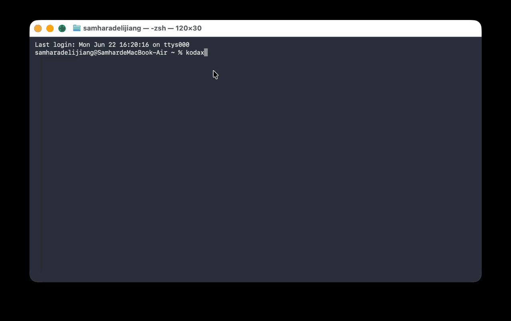

<p align="center">
  <picture>
    <source media="(prefers-color-scheme: dark)" srcset="assets/logo-dark.svg">
    <source media="(prefers-color-scheme: light)" srcset="assets/logo-light.svg">
    
  </picture>
</p>

<p align="center">
  <b>Source-available AI coding agent on every LLM you can reach.</b><br>
  Anthropic · OpenAI · DeepSeek · Kimi · Zhipu · MiniMax · MiMo · Ark · Qwen · Gemini · Codex.<br>
  REPL · CLI · library · Node-free single binary.
</p>

<p align="center">
  <a href="https://www.npmjs.com/package/@kodax-ai/kodax"></a>
  <a href="LICENSE"></a>
  <a href="https://github.com/icetomoyo/KodaX/stargazers"></a>
  <a href="https://github.com/icetomoyo/KodaX/actions"></a>
  
</p>

<p align="center">
  <a href="#install">Install</a> ·
  <a href="#why-kodax">Why KodaX</a> ·
  <a href="#providers">Providers</a> ·
  <a href="#multi-agent">Multi-agent</a> ·
  <a href="#sdk-usage">SDK</a> ·
  <a href="CHANGELOG.md">Changelog</a> ·
  <a href="docs/FEATURE_LIST.md">Roadmap</a> ·
  <a href="https://github.com/icetomoyo/KodaX/discussions">Discussions</a> ·
  <a href="README_CN.md">中文 README</a>
</p>

<p align="center">
  
</p>

---

## Why KodaX

Most coding agents lock you into one provider. KodaX doesn't.

<table>
  <tr>
    <td width="33%" valign="top">
      <h3>🇨🇳 6 China-native LLMs</h3>
      First-class adapters for Zhipu, Kimi, MiniMax, MiMo, Ark, and Qwen — not OpenAI-compat shims. Cross-provider <a href="benchmark/EVAL_GUIDELINES.md">prompt-eval calibration</a> on a canonical 5-alias panel keeps quality consistent across providers.
    </td>
    <td width="33%" valign="top">
      <h3>📦 Node-free single binary</h3>
      Bun-compiled for Windows, macOS, and Linux (x64 + arm64). Drop one file, run anywhere — restricted envs, CI runners, air-gapped boxes, machines you can't touch.
    </td>
    <td width="33%" valign="top">
      <h3>🌳 Branchable sessions</h3>
      Session history is a DAG, not a list. Fork a conversation, explore a direction, rewind if it goes wrong. Exact recovery after crashes — no silent data loss.
    </td>
  </tr>
  <tr>
    <td valign="top">
      <h3>🤖 Multi-agent by default</h3>
      <code>spawn_agent</code>, <code>send_message</code>, <code>followup_task</code>, and <code>interrupt_agent</code> are first-class tools. Runtime-owned Actor tree with safe-boundary steering, evidence-based result review, and multi-instance auto-coordination.
    </td>
    <td valign="top">
      <h3>🧩 Skills + self-construction</h3>
      Reusable Markdown Skills triggered by natural language or explicit slash invocation. A 5-stage self-modification pipeline (scaffold → validate → stage → test → activate) gated by an 8-invariant admission contract.
    </td>
    <td valign="top">
      <h3>🔍 Repo Intelligence</h3>
      Built-in <code>repo_overview</code>, <code>module_context</code>, <code>symbol_context</code>, <code>impact_estimate</code>, and more. The agent understands large codebases without ad-hoc grep exploration.
    </td>
  </tr>
</table>

---

## Install

```bash
npm i -g @kodax-ai/kodax
```

Set any one API key and run:

```bash
export ZHIPU_API_KEY=your_key   # or ANTHROPIC_API_KEY / OPENAI_API_KEY / DEEPSEEK_API_KEY / ...
kodax
```

You're in the REPL. No Node on the target machine? Download a single binary from [GitHub Releases](https://github.com/icetomoyo/KodaX/releases).

```bash
# Interactive setup wizard — picks up existing keys, no key collection
kodax setup

# Guided custom OpenAI/Anthropic-compatible provider
kodax setup --custom
```

---

## Four ways to use KodaX

| Form | Command / Import | When to use it |
|---|---|---|
| **REPL** | `kodax` | Interactive multi-turn session with streaming UI, permissions, slash commands |
| **CLI** | `kodax -p "your task"` | One-shot scripted task, CI runs, batch processing |
| **Library** | `import { runKodaX } from '@kodax-ai/kodax'` | Embed in your own tool, agent, or web service |
| **Single binary** | `./kodax` | Machines without Node — no install required |

---

## Providers

16 built-in aliases. Switch with `--provider` or set it in `~/.kodax/config.json`.

| Alias | Environment Variable | Default Model |
|---|---|---|
| `anthropic` | `ANTHROPIC_API_KEY` | claude-sonnet-4-6 |
| `openai` | `OPENAI_API_KEY` | gpt-5.3-codex |
| `deepseek` | `DEEPSEEK_API_KEY` | deepseek-flash (1M ctx, image input) |
| `kimi` | `KIMI_API_KEY` | kimi-k2.7-code (262K ctx) |
| `kimi-code` | `KIMI_CODE_API_KEY` | k3-256k |
| `qwen` | `QWEN_API_KEY` | qwen3.5-plus |
| `qwen-token-plan` | `QWEN_TOKEN_API_KEY` | qwen3.8-max (1M ctx, Anthropic-compat) |
| `zhipu` | `ZHIPU_API_KEY` | glm-5 |
| `zhipu-coding` | `ZHIPU_CODING_API_KEY` | glm-5.3 (1M ctx, 128K output) |
| `zai-coding` | `ZAI_CODING_API_KEY` | glm-5.3 |
| `minimax-coding` | `MINIMAX_CODING_API_KEY` | MiniMax-M3.1-Flash (1M ctx, always-on thinking) |
| `mimo` | `MIMO_API_KEY` | mimo-v2.6-pro |
| `mimo-coding` | `MIMO_CODING_API_KEY` | mimo-v2.6-pro (image input, thinking on/off) |
| `ark-coding` | `ARK_CODING_API_KEY` | glm-5.3 (also deepseek-v4.1-flash, kimi-k3.1-pro, …) |
| `gemini-cli` | CLI auth (no KodaX key) | via gemini CLI |
| `codex-cli` | CLI auth (no KodaX key) | via codex CLI |

> Any OpenAI- or Anthropic-compatible endpoint can be added via `customProviders[]` in `~/.kodax/config.json`. See the [custom providers guide](public_docs/configuration/custom-providers.md).

```bash
# Switch providers on the fly
kodax --provider kimi "Explain the agent architecture"
kodax --provider deepseek --thinking "Find performance bottlenecks in src/"
```

---

## Sessions: fork, rewind, resume

```bash
# Start or resume a named session
kodax --session refactor "Rename getUserName to getUsername across the codebase"
kodax --session refactor "Now add deprecation warnings to the old name"

# List sessions
kodax --session list

# Fork from a previous point, try a different approach
kodax --session refactor --fork "Actually, keep the old name and just add an alias"
```

Session history is a DAG. Forks keep their parent intact; rewinds create a branch marker, not a destructive reset. After a crash or disconnect, KodaX recovers to an exact terminal state — no silent omissions.

---

## Multi-agent

KodaX runs a Runtime-owned Actor tree. You can spawn, message, and interrupt child agents from within a task:

```typescript
import { runKodaX } from '@kodax-ai/kodax';

await runKodaX({ provider: 'zhipu-coding' }, `
  spawn_agent("reviewer", "Review packages/llm/src/ for type safety issues")
  spawn_agent("tester",   "Write unit tests for any gaps you find in packages/llm/src/")
  wait_agent("reviewer")
  wait_agent("tester")
  Summarize both results
`);
```

Or from the REPL — just ask naturally:

```bash
kodax "Analyze the architecture, check test coverage, and find the riskiest bugs — run these in parallel"
```

The agent uses `spawn_agent`, `followup_task`, `send_message`, and `interrupt_agent` to coordinate. Each child runs under inherited capabilities and the root work budget. Results flow back through an evidence-gated review before the parent acts on them.

---

## Repo Intelligence

KodaX ships built-in understanding of large codebases:

```bash
# Show active engine and index state
kodax /repo-intel status

# Run with full indexing
kodax --repo-intelligence full "What are the riskiest files to change in packages/agent?"
```

Built-in tools the agent uses automatically: `repo_overview`, `module_context`, `symbol_context`, `process_context`, `impact_estimate`, `changed_scope`, `changed_diff`. No external service, no separate install.

---

## Safety and permissions

Four permission modes, set per session:

```bash
kodax --mode plan          # Propose only — no file changes without approval
kodax --mode accept-edits  # File edits auto-approved, shell commands need approval
kodax --mode auto          # Auto-approve safe commands via LLM review
kodax --mode full-access   # No prompts (CI / trusted environments)
```

The optional ASRT sandbox routes shell commands through an isolated account on Windows or Seatbelt/bubblewrap on macOS/Linux:

```bash
kodax sandbox doctor   # Check readiness
kodax sandbox setup    # Activate (Windows: UAC prompt once)
```

Isolated Skill Script execution uses native protocol 10, which is POSIX-only. On Windows this route is unavailable because it requires per-command `denyRead`, which the Windows sandbox does not support.

---

## Skills

Reusable Markdown instructions the agent can trigger naturally or explicitly:

```bash
# Natural language — no slash needed
kodax "帮我审查代码"             # Triggers code-review skill
kodax "Review the auth changes"  # Same

# Explicit slash invocation
kodax /code-review src/
kodax /tdd packages/repl/src/
```

Built-in skills: `code-review`, `tdd`, `git-workflow`, `skill-creator`, `visual-review`.

Custom skills live in `~/.kodax/skills/`. The agent can build new skills for you via `skill-creator` and promote them to your catalog with `/learn promote`.

---

## Project instructions

Drop Markdown rules into `~/.kodax/rules/` (user-global) or `<project>/.kodax/rules/` (project-scoped). KodaX loads them in filename order before every task — no config needed.

For enforced command approvals, use `exec-policy.jsonc` in the same directory.

---

## SDK usage

### Simple one-shot

```typescript
import { runKodaX } from '@kodax-ai/kodax';

const result = await runKodaX(
  { provider: 'zhipu-coding', effort: 'auto' },
  'Summarize the architecture of this codebase'
);
```

### Custom provider

```typescript
import { registerCustomProviders, runKodaX } from '@kodax-ai/kodax';

registerCustomProviders([{
  name: 'my-llm',
  protocol: 'openai',
  baseUrl: 'https://example.com/v1',
  apiKeyEnv: 'MY_LLM_API_KEY',
  model: 'my-model',
}]);

await runKodaX({ provider: 'my-llm' }, 'Explain this file');
```

### Shared daemon (Space / IDE / desktop apps)

```typescript
import { ensureKodaXClient } from '@kodax-ai/kodax/client';

const client = await ensureKodaXClient();
try {
  const sessions = await client.sessions.list();
  console.log(`Sessions: ${sessions.length}`);
} finally {
  await client.disconnect(); // Host and Runs stay alive
}
```

The Host owns execution, settings and persistence; the UI submits inputs and observes from `sessions.observe`. See the [SDK embedder guide](public_docs/sdk/embedder-guide.md) and [Client contract](docs/CLIENT_CONTRACT.md).

### SDK subpaths

| Subpath | What you get |
|---|---|
| `@kodax-ai/kodax/llm` | 16-alias LLM abstraction — use standalone |
| `@kodax-ai/kodax/agent` | Runner, fan-out, session-lineage, MCP, skills, tracing |
| `@kodax-ai/kodax/coding` | Coding agent + 50+ tools + repo-intelligence |
| `@kodax-ai/kodax/repl` | Full Ink/React terminal UI |
| `@kodax-ai/kodax/client` | Shared Host connection (`KodaXProductClient`) |
| `@kodax-ai/kodax/runtime` | Trusted Host facade — sessions/runs/events/permissions |
| `@kodax-ai/kodax/sandbox` | Standalone ASRT capability/doctor/setup |
| `@kodax-ai/kodax/a2a` | A2A 1.0 agent card discovery and Runtime-backed server |
| `@kodax-ai/kodax/skills` | Skills system only (smaller bundle) |
| `@kodax-ai/kodax/mcp` | MCP only (smaller bundle) |

---

## How KodaX compares

| Feature | **KodaX** | Claude Code | Aider | Codex CLI | Cursor | Cline |
|---|---|---|---|---|---|---|
| Source license | ⚠️ KAI-FCL, non-commercial | ❌ Source-available | ✅ Apache 2.0 | ✅ Apache 2.0 | ❌ Proprietary | ✅ Apache 2.0 |
| Node-free single binary | ✅ Bun | ❌ Node | ❌ Python | ✅ Rust | ❌ Electron | ❌ Extension |
| Native China providers<br><sub>(Zhipu · Kimi · MiniMax · MiMo · Ark · Qwen)</sub> | ✅ 6 native | ❌ | ⚠ via LiteLLM | ❌ OpenAI-first | ❌ | ⚠ Kimi / Qwen / DeepSeek |
| Branchable session lineage | ✅ fork & rewind | ⚠ routines / sessions | ❌ | ❌ | ❌ | ⚠ checkpoints |
| Multi-agent + MCP + 50+ tools | ✅ all three | ✅ all three | ⚠ tools, no MCP | ✅ all three | ⚠ Composer + MCP | ✅ all three |

<sub>Data verified November 2026 against public docs ([Claude Code](https://github.com/anthropics/claude-code) · [Aider](https://aider.chat/docs/llms.html) · [Codex CLI](https://github.com/openai/codex) · [Cursor](https://cursor.com) · [Cline](https://github.com/cline/cline)). ⚠ = partial / requires extra setup / not first-class. Corrections welcome via PR.</sub>

---

## Architecture

Four packages, one published bundle.

```
KodaX/
├── packages/
│   ├── llm/      # LLM abstraction — 16 built-in provider aliases + custom registration
│   ├── agent/    # Agent framework — Runner, fan-out, session-lineage, MCP, skills, tracing
│   ├── coding/   # Coding agent — 50+ tools, role prompts, repo-intelligence
│   └── repl/     # Interactive terminal UI (Ink/React)
├── src/          # CLI entry point + SDK subpath re-exports
└── docs/         # ADR, HLD, DD, PRD, feature designs, test guides
```

All four ship as a single `@kodax-ai/kodax` package with 17 SDK subpaths. Each package is independently usable — no circular dependencies, no hidden coupling.

For the full dependency diagram and SDK surface map, see [docs/HLD.md](docs/HLD.md).

---

## Tools reference

50+ built-in tools across six categories:

**Files** — `read`, `write`, `edit`, `multi_edit`, `insert_after_anchor`, `undo`

**Shell & search** — `bash` (background-capable), `glob`, `grep`, `code_search`, `semantic_lookup`, `web_search`, `web_fetch`

**Repo intelligence** — `repo_overview`, `module_context`, `symbol_context`, `process_context`, `impact_estimate`, `changed_scope`, `changed_diff`, `changed_diff_bundle`

**Git worktree** — `worktree_create`, `worktree_remove`

**Agent control** — `spawn_agent`, `send_message`, `followup_task`, `wait_agent`, `interrupt_agent`, `list_agents`, `agent_output`, `run_workflow`

**UX** — `ask_user_question`, `exit_plan_mode`

**MCP** — `mcp_search`, `mcp_describe`, `mcp_call`, `mcp_read_resource`, `mcp_get_prompt` (when MCP servers are configured)

---

## Development

```bash
git clone https://github.com/icetomoyo/KodaX.git
cd KodaX
npm install
npm run build
npm link

# Dev mode
npm run dev "your task"

# Tests
npm test
npm run test:fast     # Fast tier only
npm run test:eval     # Eval-driven tests (provider matrices, identity round-trip)

# Build standalone binary
npm run build:binary          # Current platform
npm run build:binary:all      # All 5 targets
```

Supported binary targets: `win-x64`, `linux-x64`, `linux-arm64`, `darwin-x64`, `darwin-arm64`.

---

## Documentation

| Document | Purpose |
|---|---|
| [README_CN.md](README_CN.md) | 中文文档 |
| [public_docs/sdk/embedder-guide.md](public_docs/sdk/embedder-guide.md) | SDK hosting, shared Runtime daemon, permission routing, compaction/history recovery |
| [public_docs/configuration/](public_docs/configuration/) | Providers, custom providers, permissions, sandbox |
| [docs/CLIENT_CONTRACT.md](docs/CLIENT_CONTRACT.md) | Product Client SDK contract |
| [docs/SDK_MIGRATION.md](docs/SDK_MIGRATION.md) | Upgrade guide for SDK integrators |
| [docs/ADR.md](docs/ADR.md) | Architecture decision records |
| [docs/HLD.md](docs/HLD.md) | High-level design |
| [docs/DD.md](docs/DD.md) | Detailed design |
| [docs/FEATURE_LIST.md](docs/FEATURE_LIST.md) | Feature tracking and roadmap |
| [CHANGELOG.md](CHANGELOG.md) | Version history ([archive](docs/CHANGELOG_ARCHIVE.md) for older) |
| [docs/release.md](docs/release.md) | Binary build and release pipeline |

---

## Contributing

See [CONTRIBUTING.md](CONTRIBUTING.md) for contributor setup, architecture walkthrough, and code style guide.

---

## Release notes

Per-release changes are in [CHANGELOG.md](CHANGELOG.md). SDK integrators upgrading across releases should follow the [SDK migration guide](docs/SDK_MIGRATION.md).

---

## License

[KodaX-AI Fair Core License (KAI-FCL) 1.0](LICENSE) — Copyright 2026 [icetomoyo](mailto:icetomoyo@gmail.com).

KAI-FCL is source-available / fair-core, not OSI open source. Commercial, enterprise, managed deployment, paid service, or customer redistribution use requires KodaX-AI authorization where required.

Official KodaX 0.7.70 and later distributions use KAI-FCL or accompanying KodaX-AI customer terms. Historical tags, archives, binaries, and npm packages already distributed with Apache-2.0 notices remain Apache-2.0 for those specific copies.
