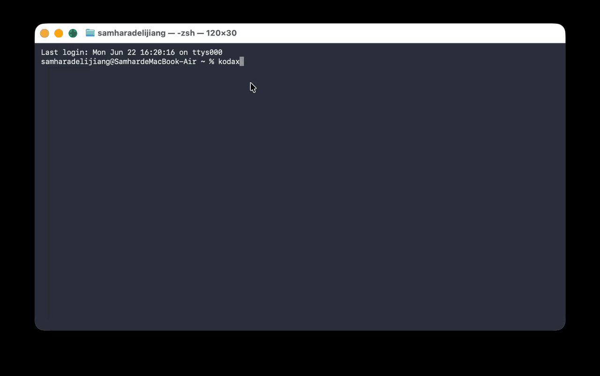

<p align="center">
  <picture>
    <source media="(prefers-color-scheme: dark)" srcset="assets/logo-dark.svg">
    <source media="(prefers-color-scheme: light)" srcset="assets/logo-light.svg">
    
  </picture>
</p>

<p align="center">
  <b>在所有你能接入的 LLM 上运行的源可用 AI 编程 Agent。</b><br>
  Anthropic · OpenAI · DeepSeek · Kimi · Zhipu · MiniMax · MiMo · Ark · Qwen · Gemini · Codex。<br>
  REPL · CLI · 库 · 无需 Node 的单文件二进制。
</p>

<p align="center">
  <a href="https://www.npmjs.com/package/@kodax-ai/kodax"></a>
  <a href="LICENSE"></a>
  <a href="https://github.com/icetomoyo/KodaX/stargazers"></a>
  <a href="https://github.com/icetomoyo/KodaX/actions"></a>
  
</p>

<p align="center">
  <a href="#安装">安装</a> ·
  <a href="#为什么选-kodax">为什么选 KodaX</a> ·
  <a href="#模型提供商">模型提供商</a> ·
  <a href="#多-agent">多 Agent</a> ·
  <a href="#sdk-用法">SDK</a> ·
  <a href="CHANGELOG.md">更新日志</a> ·
  <a href="docs/FEATURE_LIST.md">路线图</a> ·
  <a href="https://github.com/icetomoyo/KodaX/discussions">讨论区</a> ·
  <a href="README.md">English README</a>
</p>

<p align="center">
  
</p>

---

## 为什么选 KodaX

大多数编程 Agent 把你锁定在单一提供商上。KodaX 不会。

<table>
  <tr>
    <td width="33%" valign="top">
      <h3>🇨🇳 6 个国产 LLM 原生支持</h3>
      智谱、Kimi、MiniMax、MiMo、Ark、Qwen 均有原生适配器，而非 OpenAI 兼容层包装。跨提供商<a href="benchmark/EVAL_GUIDELINES.md">提示词 Eval 校准</a>，用标准 5 别名面板保持不同提供商质量一致。
    </td>
    <td width="33%" valign="top">
      <h3>📦 无需 Node 的单文件二进制</h3>
      Bun 编译，支持 Windows、macOS 和 Linux（x64 + arm64）。下载一个文件即可运行——适用于受限环境、CI Runner、隔离主机、无法安装 Node 的机器。
    </td>
    <td width="33%" valign="top">
      <h3>🌳 可分支的会话</h3>
      会话历史是有向无环图，而非线性列表。可以 Fork 一段对话、探索一个方向、出错时回退。崩溃后精确恢复——不会静默丢失数据。
    </td>
  </tr>
  <tr>
    <td valign="top">
      <h3>🤖 多 Agent 是一等公民</h3>
      <code>spawn_agent</code>、<code>send_message</code>、<code>followup_task</code>、<code>interrupt_agent</code> 均为内置工具。Runtime 管理的 Actor 树，具备安全边界转向、基于证据的结果审查和多实例自动协调。
    </td>
    <td valign="top">
      <h3>🧩 Skills + 自我构建</h3>
      可复用的 Markdown Skill，支持自然语言触发或显式斜杠调用。5 阶段自我修改流水线（脚手架→验证→暂存→测试→激活），由 8 不变式准入合约把关。
    </td>
    <td valign="top">
      <h3>🔍 仓库智能</h3>
      内置 <code>repo_overview</code>、<code>module_context</code>、<code>symbol_context</code>、<code>impact_estimate</code> 等工具。Agent 可理解大型代码库，无需临时 grep 探索。
    </td>
  </tr>
</table>

---

## 安装

```bash
npm i -g @kodax-ai/kodax
```

设置任意一个 API Key 然后运行：

```bash
export ZHIPU_API_KEY=your_key   # 或 ANTHROPIC_API_KEY / OPENAI_API_KEY / DEEPSEEK_API_KEY / ...
kodax
```

你就进入了 REPL。目标机器上没有 Node？从 [GitHub Releases](https://github.com/icetomoyo/KodaX/releases) 下载单文件二进制即可。

```bash
# 交互式配置向导——自动读取已有 Key，不收集 Key
kodax setup

# 引导式添加自定义 OpenAI/Anthropic 兼容提供商
kodax setup --custom
```

---

## 四种使用方式

| 形式 | 命令 / 导入 | 适用场景 |
|---|---|---|
| **REPL** | `kodax` | 流式 UI 的交互式多轮会话，含权限管理和斜杠命令 |
| **CLI** | `kodax -p "你的任务"` | 单次脚本任务、CI 运行、批量处理 |
| **库** | `import { runKodaX } from '@kodax-ai/kodax'` | 嵌入自有工具、Agent 或 Web 服务 |
| **单文件二进制** | `./kodax` | 无 Node 机器——无需安装 |

---

## 模型提供商

16 个内置别名。用 `--provider` 切换，或在 `~/.kodax/config.json` 中设置。

| 别名 | 环境变量 | 默认模型 |
|---|---|---|
| `anthropic` | `ANTHROPIC_API_KEY` | claude-sonnet-4-6 |
| `openai` | `OPENAI_API_KEY` | gpt-5.3-codex |
| `deepseek` | `DEEPSEEK_API_KEY` | deepseek-flash（1M ctx，支持图像输入） |
| `kimi` | `KIMI_API_KEY` | kimi-k2.7-code（262K ctx） |
| `kimi-code` | `KIMI_CODE_API_KEY` | k3-256k |
| `qwen` | `QWEN_API_KEY` | qwen3.5-plus |
| `qwen-token-plan` | `QWEN_TOKEN_API_KEY` | qwen3.8-max（1M ctx，Anthropic 兼容） |
| `zhipu` | `ZHIPU_API_KEY` | glm-5 |
| `zhipu-coding` | `ZHIPU_CODING_API_KEY` | glm-5.3（1M ctx，128K 输出） |
| `zai-coding` | `ZAI_CODING_API_KEY` | glm-5.3 |
| `minimax-coding` | `MINIMAX_CODING_API_KEY` | MiniMax-M3.1-Flash（1M ctx，常驻思考模式） |
| `mimo` | `MIMO_API_KEY` | mimo-v2.6-pro |
| `mimo-coding` | `MIMO_CODING_API_KEY` | mimo-v2.6-pro（图像输入，思考开/关） |
| `ark-coding` | `ARK_CODING_API_KEY` | glm-5.3（也支持 deepseek-v4.1-flash、kimi-k3.1-pro……） |
| `gemini-cli` | CLI 鉴权（无需 KodaX Key） | 通过 gemini CLI |
| `codex-cli` | CLI 鉴权（无需 KodaX Key） | 通过 codex CLI |

> 任何 OpenAI 或 Anthropic 兼容端点均可通过 `~/.kodax/config.json` 中的 `customProviders[]` 添加。详见[自定义提供商指南](public_docs/configuration/custom-providers.md)。

```bash
# 即时切换提供商
kodax --provider kimi "解释一下 agent 架构"
kodax --provider deepseek --thinking "找出 src/ 中的性能瓶颈"
```

---

## 会话：Fork、回退、恢复

```bash
# 启动或恢复命名会话
kodax --session refactor "将 getUserName 重命名为 getUsername"
kodax --session refactor "现在给旧名称加上弃用警告"

# 列出会话
kodax --session list

# 从某个历史节点 Fork，尝试不同方向
kodax --session refactor --fork "其实保留旧名称，只加一个别名就好"
```

会话历史是有向无环图。Fork 保留父节点不变；回退创建分支标记，而非破坏性重置。崩溃或断连后，KodaX 精确恢复到终止时的状态——不会静默遗漏。

---

## 多 Agent

KodaX 运行一个 Runtime 管理的 Actor 树。你可以在任务内 spawn、发消息、中断子 Agent：

```typescript
import { runKodaX } from '@kodax-ai/kodax';

await runKodaX({ provider: 'zhipu-coding' }, `
  spawn_agent("reviewer", "检查 packages/llm/src/ 的类型安全问题")
  spawn_agent("tester",   "为 packages/llm/src/ 中发现的不足编写单元测试")
  wait_agent("reviewer")
  wait_agent("tester")
  汇总两者结果
`);
```

或直接在 REPL 里自然表达：

```bash
kodax "分析架构、检查测试覆盖率、找出最危险的 bug——并行执行"
```

Agent 会自动使用 `spawn_agent`、`followup_task`、`send_message`、`interrupt_agent` 进行协调。每个子 Agent 在继承的权限和根工作预算下运行。结果经过基于证据的审查后，父 Agent 才会采纳。

---

## 仓库智能

KodaX 内置对大型代码库的理解能力：

```bash
# 查看当前引擎和索引状态
kodax /repo-intel status

# 开启完整索引运行
kodax --repo-intelligence full "packages/agent/ 中最危险的改动区域是哪里？"
```

Agent 自动调用的内置工具：`repo_overview`、`module_context`、`symbol_context`、`process_context`、`impact_estimate`、`changed_scope`、`changed_diff`。无需外部服务，无需单独安装。

---

## 安全与权限

四种权限模式，按会话设置：

```bash
kodax --mode plan          # 仅提议——文件修改需审批
kodax --mode accept-edits  # 文件编辑自动通过，Shell 命令需审批
kodax --mode auto          # 通过 LLM 审查自动批准安全命令
kodax --mode full-access   # 无提示（CI / 可信环境）
```

可选的 ASRT 沙箱在 Windows 上通过隔离账户、在 macOS/Linux 上通过 Seatbelt/bubblewrap 隔离 Shell 命令：

```bash
kodax sandbox doctor   # 检查就绪状态
kodax sandbox setup    # 激活（Windows：UAC 提示一次）
```

隔离 Skill Script 执行使用 native protocol 10，仅支持 POSIX。由于该路由需要每命令 `denyRead`，而 Windows 沙箱不支持此策略，因此 Windows 不可用。

---

## Skills

可复用的 Markdown 指令，支持自然触发或显式斜杠调用：

```bash
# 自然语言——无需斜杠
kodax "帮我审查代码"             # 触发 code-review skill
kodax "Review the auth changes"  # 同上

# 显式斜杠调用
kodax /code-review src/
kodax /tdd packages/repl/src/
```

内置 Skill：`code-review`、`tdd`、`git-workflow`、`skill-creator`、`visual-review`。

自定义 Skill 存放于 `~/.kodax/skills/`。Agent 可通过 `skill-creator` 为你构建新 Skill，并用 `/learn promote` 加入你的目录。

---

## 项目指令

将 Markdown 规则放入 `~/.kodax/rules/`（用户全局）或 `<project>/.kodax/rules/`（项目作用域）。KodaX 在每次任务前按文件名顺序加载——无需任何配置。

如需强制执行命令审批策略，在同一目录下使用 `exec-policy.jsonc`。

---

## SDK 用法

### 简单单次调用

```typescript
import { runKodaX } from '@kodax-ai/kodax';

const result = await runKodaX(
  { provider: 'zhipu-coding', effort: 'auto' },
  '总结这个代码库的架构'
);
```

### 自定义提供商

```typescript
import { registerCustomProviders, runKodaX } from '@kodax-ai/kodax';

registerCustomProviders([{
  name: 'my-llm',
  protocol: 'openai',
  baseUrl: 'https://example.com/v1',
  apiKeyEnv: 'MY_LLM_API_KEY',
  model: 'my-model',
}]);

await runKodaX({ provider: 'my-llm' }, '解释这个文件');
```

### 共享 Daemon（Space / IDE / 桌面应用）

```typescript
import { ensureKodaXClient } from '@kodax-ai/kodax/client';

const client = await ensureKodaXClient();
try {
  const sessions = await client.sessions.list();
  console.log(`会话数：${sessions.length}`);
} finally {
  await client.disconnect(); // Host 和 Run 保持运行
}
```

Host 负责执行、设置和持久化；UI 通过 `sessions.observe` 提交输入并观察结果。详见 [SDK 嵌入指南](public_docs/sdk/embedder-guide.md)和 [Client 契约](docs/CLIENT_CONTRACT.md)。

### SDK 子路径

| 子路径 | 内容 |
|---|---|
| `@kodax-ai/kodax/llm` | 16 别名 LLM 抽象层——可独立使用 |
| `@kodax-ai/kodax/agent` | Runner、扇出、会话谱系、MCP、Skills、追踪 |
| `@kodax-ai/kodax/coding` | 编程 Agent + 50+ 工具 + 仓库智能 |
| `@kodax-ai/kodax/repl` | 完整 Ink/React 终端 UI |
| `@kodax-ai/kodax/client` | 共享 Host 连接（`KodaXProductClient`） |
| `@kodax-ai/kodax/runtime` | 受信 Host Facade——会话/运行/事件/权限 |
| `@kodax-ai/kodax/sandbox` | 独立 ASRT 能力检测/setup |
| `@kodax-ai/kodax/a2a` | A2A 1.0 Agent Card 发现与 Runtime 支持的服务端 |
| `@kodax-ai/kodax/skills` | 仅 Skills 系统（体积更小） |
| `@kodax-ai/kodax/mcp` | 仅 MCP（体积更小） |

---

## KodaX 与同类产品对比

| 特性 | **KodaX** | Claude Code | Aider | Codex CLI | Cursor | Cline |
|---|---|---|---|---|---|---|
| 源码许可 | ⚠️ KAI-FCL，非商业 | ❌ 源可用 | ✅ Apache 2.0 | ✅ Apache 2.0 | ❌ 专有 | ✅ Apache 2.0 |
| 无需 Node 的单文件二进制 | ✅ Bun | ❌ Node | ❌ Python | ✅ Rust | ❌ Electron | ❌ 扩展 |
| 国产 LLM 原生支持<br><sub>（智谱·Kimi·MiniMax·MiMo·Ark·Qwen）</sub> | ✅ 6 个原生 | ❌ | ⚠ 需 LiteLLM | ❌ OpenAI 优先 | ❌ | ⚠ Kimi/Qwen/DeepSeek |
| 可分支会话谱系 | ✅ Fork & 回退 | ⚠ routines/sessions | ❌ | ❌ | ❌ | ⚠ 检查点 |
| 多 Agent + MCP + 50+ 工具 | ✅ 三者全有 | ✅ 三者全有 | ⚠ 工具，无 MCP | ✅ 三者全有 | ⚠ Composer + MCP | ✅ 三者全有 |

<sub>数据于 2026 年 11 月根据公开文档核实（[Claude Code](https://github.com/anthropics/claude-code) · [Aider](https://aider.chat/docs/llms.html) · [Codex CLI](https://github.com/openai/codex) · [Cursor](https://cursor.com) · [Cline](https://github.com/cline/cline)）。⚠ = 部分支持 / 需额外配置 / 非一等公民。欢迎通过 PR 纠错。</sub>

---

## 架构

四个 Package，一个发布包。

```
KodaX/
├── packages/
│   ├── llm/      # LLM 抽象层——16 个内置提供商别名 + 自定义注册
│   ├── agent/    # Agent 框架——Runner、扇出、会话谱系、MCP、Skills、追踪
│   ├── coding/   # 编程 Agent——50+ 工具、角色提示、仓库智能
│   └── repl/     # 交互式终端 UI（Ink/React）
├── src/          # CLI 入口 + SDK 子路径重导出
└── docs/         # ADR、HLD、DD、PRD、功能设计、测试指南
```

四个 Package 作为单一 `@kodax-ai/kodax` 包发布，提供 17 个 SDK 子路径。每个 Package 均可独立使用——无循环依赖，无隐式耦合。

完整依赖图和 SDK 接口图详见 [docs/HLD.md](docs/HLD.md)。

---

## 工具参考

50+ 个内置工具，分六类：

**文件** — `read`、`write`、`edit`、`multi_edit`、`insert_after_anchor`、`undo`

**Shell 与搜索** — `bash`（支持后台运行）、`glob`、`grep`、`code_search`、`semantic_lookup`、`web_search`、`web_fetch`

**仓库智能** — `repo_overview`、`module_context`、`symbol_context`、`process_context`、`impact_estimate`、`changed_scope`、`changed_diff`、`changed_diff_bundle`

**Git Worktree** — `worktree_create`、`worktree_remove`

**Agent 控制** — `spawn_agent`、`send_message`、`followup_task`、`wait_agent`、`interrupt_agent`、`list_agents`、`agent_output`、`run_workflow`

**UX** — `ask_user_question`、`exit_plan_mode`

**MCP** — `mcp_search`、`mcp_describe`、`mcp_call`、`mcp_read_resource`、`mcp_get_prompt`（配置 MCP 服务器后可用）

---

## 开发

```bash
git clone https://github.com/icetomoyo/KodaX.git
cd KodaX
npm install
npm run build
npm link

# 开发模式
npm run dev "你的任务"

# 测试
npm test
npm run test:fast     # 仅快速层
npm run test:eval     # Eval 驱动测试（提供商矩阵、身份轮转）

# 构建独立二进制
npm run build:binary          # 当前平台
npm run build:binary:all      # 全部 5 个目标
```

支持的二进制目标：`win-x64`、`linux-x64`、`linux-arm64`、`darwin-x64`、`darwin-arm64`。

---

## 文档

| 文档 | 用途 |
|---|---|
| [README.md](README.md) | English 文档 |
| [public_docs/sdk/embedder-guide.md](public_docs/sdk/embedder-guide.md) | SDK 托管、共享 Runtime Daemon、权限路由、压缩/历史恢复 |
| [public_docs/configuration/](public_docs/configuration/) | 提供商、自定义提供商、权限、沙箱 |
| [docs/CLIENT_CONTRACT.md](docs/CLIENT_CONTRACT.md) | Product Client SDK 契约 |
| [docs/SDK_MIGRATION.md](docs/SDK_MIGRATION.md) | SDK 集成者升级指南 |
| [docs/ADR.md](docs/ADR.md) | 架构决策记录 |
| [docs/HLD.md](docs/HLD.md) | 高层设计 |
| [docs/DD.md](docs/DD.md) | 详细设计 |
| [docs/FEATURE_LIST.md](docs/FEATURE_LIST.md) | 功能跟踪与路线图 |
| [CHANGELOG.md](CHANGELOG.md) | 版本历史（旧版见[归档](docs/CHANGELOG_ARCHIVE.md)） |
| [docs/release.md](docs/release.md) | 二进制构建与发布流水线 |

---

## 贡献

贡献者配置、架构导览和代码风格指南详见 [CONTRIBUTING.md](CONTRIBUTING.md)。

---

## 发布说明

每个版本的改动见 [CHANGELOG.md](CHANGELOG.md)。跨版本升级的 SDK 集成者请遵循 [SDK 迁移指南](docs/SDK_MIGRATION.md)。

---

## 许可证

[KodaX-AI Fair Core License（KAI-FCL）1.0](LICENSE) — Copyright 2026 [icetomoyo](mailto:icetomoyo@gmail.com)。

KAI-FCL 是源可用 / Fair Core 许可，而非 OSI 开源许可。商业、企业、托管部署、付费服务或客户再分发用途，在需要时须获得 KodaX-AI 授权。

KodaX 0.7.70 及以后版本的官方发行版使用 KAI-FCL 或附带的 KodaX-AI 客户条款。此前已以 Apache-2.0 声明分发的历史 tag、归档、二进制和 npm 包，对应的那些特定副本仍遵循 Apache-2.0。
