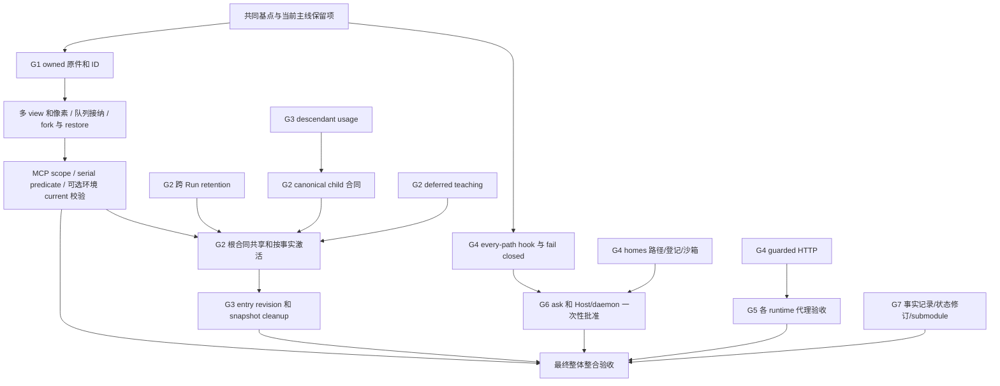

# KodaX-next-dev 全分支整合评估（2026-11-06）

结论：**有理由在完成分组验收后整合整个 next-dev，但目前不能据此直接判定整支可发布。** 分支包含视觉证据、请求合同与缓存、预算归属、SDK 安全边界、代理、人工审批等多个完整功能族；它不是一个压缩修复分支。已经回移的 scratchpad parser 修复可以独立成立，不能代替剩余功能的评估，也不要求先合并整支才能修小上下文问题。

本文是供后续整合执行的评估和验收计划，**不是已完成合并或新增产品承诺**。本次只读源码、历史、既有测试和验收记录，未合并、未 push、未启动付费模型评测，未将旧验收结果改写为当前候选已通过。引用直接落在提交和可追溯的设计/测试文件，不依赖本地忽略的 research 草稿。

## 1. 固定输入与覆盖范围

| 输入 | 冻结值 | 含义 |
| --- | --- | --- |
| 当前主线评估基点 | `37baedc7c84083fa0a54229cfad700741c2ed072` | 含已回移 parser；其父为 `587f9a9ba23fb517db37fc990a6fd72ac5188199` |
| next-dev | `8a952c9815c6b9769b8b61b48fa1e77c437593dd` | 本文所有 next-dev 源码判断的版本 |
| merge-base | `e733e51f98fc5df7538a3dfc2438fed784345b33` | 共同的 v0.7.97-beta.1 基点 |
| 独有提交 | 主线 15；next-dev 62 | 主线原有 14 个加 parser；next-dev 为 58 个非 merge、4 个 merge |
| next-dev 相对共同基点 | 315 文件，39,827 插入、673 删除 | 含大量设计、测试、历史实验记录，不能当作全部生产代码体量 |
| 只读模拟 | `git merge-tree --write-tree 37baedc7c 8a952c981` | 8 个冲突路径；未修改工作树/index；结果对象 `e0a173fa569607941653258101d96e8c00166cd1` |

可复查命令：`git log --reverse --format='%h|%s' 37baedc7c..8a952c981`、`git log 8a952c981..37baedc7c`、`git diff --stat e733e51f9 8a952c981`。逐提交判断见第 4 节，**62 个均已列出，包括 merge 与仅文档提交**。

评估期间主线继续推进到 `1eca089ba341cd3e55cf89574dd9e34bb27896d6`：新增 `64b218be8`（拒收显式截断摘要）和 `1eca089ba`（输入容量错误方言进入恢复）；摘要容量与分页代码当时仍有工作区改动。它们属于当前容量可靠性工作，**不在上述 15/62 清单中，也不来自 next-dev**。真正整合时必须改用最终已提交主线重算冲突与验收，不能直接复用本次模拟对象。相关计划见 [context-capacity-reliability-plan-2026-11-06.md](context-capacity-reliability-plan-2026-11-06.md)。

### 已等价回移与“git cherry 全部 +”的区别

`2cd1b7420bca10f3595db24b1fb2f7b150bbf9a9` 共改 6 文件；其中 `summary-generator.ts`、相邻单测、REPL parity 测试三文件的 **101 插入/4 删除**已由 `37baedc7c` 回移。其余三文件为视觉理解 pilot 的设计/成本记录，不能为得到 parser 而一并视作必要依赖。`git cherry` 对 58 个非 merge 全部显示 `+`，是完整 patch 层面的结果；原提交含额外文档，不能据此说 parser 尚未合入。原 parser patch-id 为 `28ea5a068f85d8511a97261d6cb29158d891567d`（三文件范围）。来源：上述两提交及 `git show <sha> -- <三个路径>`。

剩余 parser 文档可以随全分支历史进入，须保持原 pilot 日期、版本、样本边界。它们不能给新加入的 `max_tokens` 拒收、分块压缩和超大文本分页提供验收证据。反过来，全分支合并也必须保留这些新容量修复，不能用 next-dev 较旧的 `summary-generator.ts` 整文件覆盖主线。

## 2. 功能族、真实依赖与整合收益

以下 G 编号用于提交表和验收表。依赖是代码/合同的先后约束，不是建议逐条 cherry-pick 复杂分支历史。

| 族 | 完整范围与收益 | 主要依赖、风险与判断 |
| --- | --- | --- |
| G1 视觉证据底座 | owned 原件、持久 ID、历史查询、inspect 多 view、精确像素、fork/restore/compaction、队列接纳、MCP 来源；P6 可选 card 环境 | 应作为有完整来源链的功能族整合，不能只摘工具入口。新 agent `image-size` 依赖、新 coding `./visual-environment` export 要保证独立包可用。媒体可恢复不等于语言理解保真；默认推广新视觉方法没有充分净收益证据。 |
| G2 请求合同与缓存 | 跨 Run 保留 Managed Run Context；内建 child 合同缩减；deferred teaching 去重；根规则共享；按已知事实暴露合同 | 需要真实来源/完整 canonical schema 校验及 fallback。与主线 scoped Markdown rules、Script typed data/原件保存重叠。缓存命中率提升不能替代总 token、权限实时性或任务质量验收。 |
| G3 预算、历史与清理 | descendant usage 计入 root goal；entry-scoped history revision；全局 snapshot 清理异步让出 | 预算必须恰好计一次，子任务取消/失败也结算；history 可见证据变化仍应失效；异步清理不能在 close/cancel 后重新发布已废目录。 |
| G4 扩展/网络/配置安全 | every-dispatch `tool:before`、异常/超时 fail closed、agent-home 模型写保护、web_fetch 元数据/重定向保护、KODAX_HOME 路径和多个 inline Runtime home、Windows Job 诊断 | 高价值修复，优先验证。必须与主线 final-call/pre-invoke、containment 恢复合成。不是完整网络隔离或任意 shell 的新沙箱；metadata 集合仍有明确未确认项。 |
| G5 代理与 CA（303） | Responses WebSocket 遵循环境代理；Host 缺少运行时支持时告警；既有 CA 环境配置说明 | 依赖运行时真实能力。Node 最低版本仍 >=20，配置 HTTP_PROXY 并不保证旧 Node 自动走代理。Bun 与 Node HTTP/WS 路径不能混为一个测试。 |
| G6 人工审批（304） | 扩展 `ask` → coding permission → inline/daemon Host 一次性请求；block > ask > allow | 依赖 G4 的全路径、fail closed。不能被 Full Access、已有 grant 或子调用绕开；无 handler 必须保持拒绝。Space 消费方 UI 是否接入是独立交付边界。 |
| G7 证据、文档、集成历史 | 冻结基线、P7/缓存/合同评测、mainline merge、feature gitlink | 保留历史失败和版本归属；纠正当前索引/状态的陈旧表述。不能用测试标题或原 full-suite 记录证明新组合可发布。 |

依赖图：

源码依据（下面路径均以 next-dev `8a952c981` 为准）：

- `packages/agent/src/media/visual-tools.ts:12` 定义真实多 view/像素合同；`packages/coding/src/tools/visual.ts` 与 `src/sdk-runtime.visual-sources.test.ts` 覆盖 owned 来源；`b4bbcac00` 为精确 observation ID 合同补修。不得以文件名/label 替代 ID，也不能将 JPEG 整图支持扩成 JPEG 派生采样支持。
- `packages/coding/src/task-engine/_internal/managed-task/managed-run-context-retention.ts`（`011b28d18`）按普通消息前缀 hash 保留 placement，不把恢复的旧 Host facts 自动视作新授权；可变 skills/MCP/specialist facts 与证据 facts 的保留规则不同，必须验证主线新 scoped rules 仍及时刷新。
- `packages/coding/src/prompts/compact-child-contract.ts:20` 起（`0b8d85c86`）限定内建来源、canonical prompt/schema 和配套 tool menu；`packages/coding/src/tools/managed-tool-activation.ts:83` 起（`2e8268354`）只投影普通 root 请求，陌生 schema fallback，只有 owner 明确提供 `visualSnapshotEmpty` 才隐藏未激活 detail tools。不能仅凭“没有看到图”推断历史为空。
- `packages/agent/src/session-lineage/history-retrieval.ts:558`（`55d1bc6fa`）读取 entry 并核验 revision；旧 whole-history revision 仍严格。`809fc1dc2` 的 `src/sdk-runtime.ts` diff 把清理转成异步，顺序约束是目录先发布、yield 后检查 close/cancel。
- `packages/coding/src/tools/_internal/guarded-http-get.ts:30`、`:40`、`:80`、`:120`（`03d1c9ec7`）逐 hop 校验地址和重定向，区分 direct socket 与代理；初始显式私网请求仍允许。不能宣传成禁止所有私网，或保证可见代理之后的实际终点。
- `packages/agent/src/runtime/agent-home.ts:128`（`535bad25a`）列出 process home 与活跃 inline homes；`5b12ef4c9`、`7a3214bee` 将其用于模型写边界与 shell mask。登记引用计数及失败初始化/close 释放需要作为同一生命周期验收。
- `packages/llm/src/providers/responses-socket.ts:25`、`:35`（`08a5ab9aa`）区分 Node global agent 与 Bun proxy；`src/sdk-runtime.ts:21311` 起和 `src/runtime-daemon/server.ts`（`518429e49`）连接扩展 ask 与 Host 请求，不提供永久授权建议。

## 3. 必须保住的主线变化

这些不是 next-dev 的“多余差异”。即使自动合并没有冲突，也要逐项验证存活。

| 主线提交 | 需要保住的行为 | 与 next-dev 的交叉点 |
| --- | --- | --- |
| `49da64f24` | shared Host recovery、Script lifecycle | SDK 队列、媒体 owner、home 登记、close/退出清理 |
| `532243a27` | tool 原名和 typed program data | nested dispatch、visual 来源、请求合同投影 |
| `37258ec5c` | SDK Script 生命周期和原生工具命名合同 | 不以旧 prompt/文档覆盖新合同 |
| `e177e0ce9` | 原内容保存和按需输出合同 | visual/read/Script projection 及容量预算 |
| `f689d0fe1` | 有限模型验收记录及其限制 | 保留原版本、失败、样本，不嫁接成全分支通过 |
| `142fb02f7` | session 故障诊断与受限后续方案 | 区分已经修复与未来研究，不被 next-dev 旧计划覆盖 |
| `245fe9c62` | 缺少 Node globals 的上下文说明，保留 VM 原错误 | 扩展 timeout/abort 不吞掉底层 Script 错误 |
| `e6e1c5d8a` | 已发布 Host 升级 gate 指向 beta.1 | 新组合仍跑真实已发布版本升级路径 |
| `f68a87161` | v0.7.97-beta.2 发布状态/版本 | 不回退到 next-dev 的 beta.1 package 文本 |
| `43538d573` | structured projection 超本地容量时保住原件 | G1/G2 投影不得将丢弃的展示结果当作唯一原证据 |
| `884b5e6d0` | CLI 5064 KiB 门槛（5 MiB 减 56 KiB） | next-dev 旧 5056 KiB 门槛不是“新批准更严门槛”；按主线门槛测新产物，不直接放宽 |
| `0a3728e9c` | identical Host build 跨安装复用 | 新包/ABI/feature capability 不能复用不兼容 Host |
| `d029a2f54` | scoped Markdown rule fragments | G2 rules 共享/retention/child 合同不得删除目录作用域与刷新 |
| `587f9a9ba` | 依据 verified containment 恢复 interrupted exit | Windows Job 诊断、异步清理、Runtime home 释放不能削弱证据判据 |
| `37baedc7c` | unfinished scratchpad 摘要拒收 | 与 next-dev parser 同义；保留主线更晚的 capacity 修复 |

来源为表中各提交的 patch。补充核对：`git diff 37baedc7c 8a952c981 -- scripts/build-bundle.mjs` 可看到两端门槛差异；**两端 diff 不等于三方 merge 会回退**，仍须检查实际合并结果。包版本亦同理。

## 4. 全部 62 个 next-dev 独有提交逐项评估

每行 SHA 是该行范围/行为与新增验证的 primary source，可用 `git show --stat <sha>`、`git show <sha> -- <path>` 复查。标题保留原文；“有测试”表示提交附带或复用测试，**不表示本次重新运行或语义质量已证明**。推荐项中“整合”均以前述族完整、冲突合成及第 6 节验收为条件；“保留记录”不等于默认推广实验方案。

| # / SHA / 原标题 | 范围与依赖 | 收益与主要风险 | 验证证据 / 缺口 | 推荐 |
| --- | --- | --- | --- | --- |
| 01 `1826cc228` — Merge KodaX work mode regression fixture repairs | G7；4 个 merge 之一，work-mode fixtures | 补集成测试语境；不可把导入历史当全新实现 | 含 work-mode 回归修订；合并后的实际 system bytes 仍须重验 | 保留 merge 历史，审查 resolutions，勿独立重放整个父支 |
| 02 `7bdf1a3a2` — docs: freeze visual harness P0 baseline | G7→G1 基线成本 JSON | 建立可比原点；历史估算不等于当前账单 | 冻结 P0，未证明任务收益 | 保留版本/成本口径；勿升级为验收结论 |
| 03 `58bca775a` — feat: implement durable visual recall and inspection (P1-P2) | G1 起点；agent/coding/SDK/storage/wire，新增 image-size | 持久原件和查询；owner/权限/容量贯穿多个包 | 10 个测试文件；跨包与实际 wire 为必要验收 | 与后续 G1 修补一并整合，禁止只搬工具定义 |
| 04 `30310e001` — fix: reject conflicting PNG headers before visual decoding | 依赖 03；raster parser | 拒绝矛盾 IHDR/CRC；拒收支持边界需明确 | 公共解析负例，唯一首 IHDR 和长度校验 | 必须随 03 保留，不退回宽松解码 |
| 05 `c8e10be26` — feat: inspect ordered historical image views (P3a) | 依赖 03–04；多 view、reservation、serializer | 1–4 view 保序和 partial；并发预算/取消风险 | runtime/serializer 路径与 focused 回归；组合容量未重跑 | 整合，重点验 whole-call 预留及取消释放 |
| 06 `4991f6b75` — feat: sample exact historical raster colors (P3b) | 依赖 03–05；像素采样 | 原 raster RGBA、共享 palette；不能把显示缩放值当原值 | PNG/坐标/上限测试；真实视觉推理质量另论 | 整合，保留 4096 样本和严格格式边界 |
| 07 `6dcc464e5` — feat: pin queued product visual inputs before acknowledgement (P4a) | 依赖 03；SDK 队列/owned bytes | ack 前固定证据；持久化失败/授权竞态风险 | SDK 队列测试；与主线 work-mode gate 冲突 | 整合，先授权与 work-mode 校验，成功持久化后 ack |
| 08 `74b4473ba` — feat: preserve visual evidence across forks and repeated compaction (P4b) | 依赖 03、07；lineage/compaction/fork | 多次压缩仍能取原件；跨 branch 可见性风险 | fork/重复压缩回归；不证明语言摘要保真 | 整合；和当前小窗口计划交叉验收 |
| 09 `03636561b` — fix: verify owned historical image bytes on restored runs (P4c) | 依赖 08；恢复 hash/序列化 | 防止变更/损坏原件混入；缺失原件须真实失败 | restore/tamper 路径测试 | 必须随 G1 保留，禁止缺件时静默换图 |
| 10 `b42a78c4c` — feat(visual): preserve serial predicates across tool bridges (P6a) | G1 tool bridge；依赖 registry/03 | bridge 后仍序列化；与主线 Script admittedParallel 冲突 | bridge/agent chain 回归 | 合成两侧 serial 判据；测试 native/bridge/Script 等价 |
| 11 `44163cd34` — feat(visual): add opt-in versioned card environment consumer (P6b) | 依赖 03、10；新 public export | current/action/unknown 安全样例；不是通用桌面平台 | 3 测试文件；消费者为受限 opt-in | 可随整支保留，但维持 opt-in 与公开支持范围 |
| 12 `a59196752` — feat(visual): admit typed MCP images through owned call scopes (P5) | 依赖 G1 owner 与 tool scope | typed MCP 图片带正确来源；fallback/嵌套绕过风险 | MCP、owner、SDK 测试 | 与 G4 dispatch 合成，禁止 scope 外接纳 |
| 13 `6778640e6` — test(visual): freeze pilot inputs and verify owned queued snapshots (P7) | G7/G1；依赖 07–12 | 固定实验输入和 owned 快照；harness 不能替代实际 SDK | 5 个测试/fixture 文件 | 保留 harness 和工程断言，结论限定到 fixture |
| 14 `3b2d48e8f` — fix(visual): revalidate action basis after receipt lookup | 依赖 11；异步 action basis | 关闭 receipt lookup 后的 stale/current 竞态 | 环境 action 负例 | 必须与可选消费者一起整合 |
| 15 `322ae5c47` — test(visual): measure bounded P7 pilot on Kimi Code | G7，依赖 G1 | 建立有限 pilot；单模型单任务不能泛化 | 已有成本和任务证据，未新运行 | 保留记录，不据此默认推广方法 |
| 16 `409a8f00a` — docs(visual): evaluate task outcomes before full-token tradeoffs | G7，继 15 | 明确先评质量再算 token；文档不是能力实现 | 分析既有证据 | 保留评价准则与限制 |
| 17 `cb8fe2076` — test(visual): record bounded P7 task-value attempts | G7；harness/attempts | 暴露失败成本；选择性保留成功会误导 | 多任务尝试及测试；mixed 结论 | 保留失败/未知 usage，不合并成“全部通过” |
| 18 `03ea1eda3` — test(visual): record evidence correction probes and task preflights | G7；依赖 17 | 区分输入缺陷与模型纠错；preflight 改动影响可比性 | correction probes、preflight 测试 | 保留 revision 分界，不能跨 revision 汇总成功率 |
| 19 `4c0cf681a` — test(visual): validate guided evidence and completed task costs | G7 **及 G1 生产工具 description** | 增加取证/修订教学；并非纯 test 提交，增加请求字节 | guidance-feedback 测试和成本；方法净价值未证 | 审查真实 tool bytes；保留其有限工具内教学，不扩大到全局默认 |
| 20 `011b28d18` — fix(coding): keep Managed Run Context in place across Run boundaries | G2 retention 起点 | 稳定缓存前缀；旧 facts/授权滞留与成长风险 | 9 个测试文件，hash/placement guard | 整合并与 scoped rules/新容量上限联合验收 |
| 21 `800d36870` — test: record R16 Run-boundary retention evals | G7 验 20 | 展示缓存收益；总量可能增长 | 三 provider 历史 probe；DeepSeek config 总量 223410→240013 | 保留正负证据，不能宣传总 token 一定降低 |
| 22 `676e6257b` — test: record R17 cold-start cache probe | G7 验 20 | 隔离 cold start 因素；cwd 是实验变量 | DeepSeek 单项历史 12160/12650 cached | 保留有限结论；未证明其他 provider/版本 |
| 23 `b4bbcac00` — fix(visual): close observation ID contracts and integrated delivery | G1/G7；依赖前序视觉链 | 精确 ID、JPEG 支持边界、集成交付；含 bundle guard | visual-tools 与实际 SDK source 回归、历史包验证 | 整合代码和最终交付记录；bundle 以主线当前门槛为准 |
| 24 `9c153cb03` — docs(visual): record real compaction understanding pilot | G7；G1/压缩交叉 | 有单例语义证据；不能推出所有长文压缩保真 | 已有真实 pilot，无当前窗口矩阵 | 保留为历史样本，不当容量修复验收 |
| 25 `2cd1b7420` — fix(compaction): reject unfinished scratchpad summaries | parser 三文件已等价回移；余三文档 | 拒绝空/未完 scratchpad；不覆盖所有截断 stopReason | 37baedc7c 的 RED 5、GREEN 64/4 文件由本次主线实施记录；原 pilot 单独 | 不重复回移；全支 merge 保留当前更晚实现 |
| 26 `13f2fe93d` — fix(coding): charge descendant usage to the root goal budget | G3；child/root usage sink | 子调用成本纳入预算；重复收费或漏失败 usage 风险 | 5 个测试文件；历史 coding/SDK suites | 必须与 27 结算/撤销修补共同验收 |
| 27 `0b8d85c86` — fix(coding): preserve goal usage and compact builtin child contracts | G3 完整化 + G2 child；依赖 26 | 取消/撤销后仍结算；缩减 canonical 合同 | 21 测试文件；特殊 SDK/specialist 应 fallback | 整合；usage 准确性独立于 token 收益验收 |
| 28 `1dd6d64d3` — perf(coding): remove redundant deferred tool teaching | G2；deferred discovery/adapter | 降低重复教学；可能丢失有效 schema 提示 | 8 个测试文件，实际工具合同对照 | 整合，保留 discovery 完整结果与覆盖后 fallback |
| 29 `2e8268354` — feat(coding): share root rules and activate scoped tool contracts | G2 收口，依赖 20、27、28、G1 facts | 根规则共享、request-only 激活；与新 scoped rules 和容量重叠最多 | 21 测试文件、有限真实 probe；Windows 历史单项失败另记 | 高风险语义合成；没有 source ownership 证据不得压缩自定义合同 |
| 30 `55d1bc6fa` — fix(agent): scope history read revisions to entry evidence | G3；history/tool schema | 无关 append 不使选中 entry 失效；证据变化仍要拒收 | 9 个测试文件；legacy revision 严格性 | 整合，与长文 paging 的稳定引用联合验收 |
| 31 `809fc1dc2` — fix(sdk): yield during global snapshot cleanup | G3；SDK I/O/生命周期 | 避免全局清理阻塞；yield 引入 close/cancel 竞态 | SDK 清理测试；主线恢复代码较新 | 整合，测 close/init failure/read-budget 顺序 |
| 32 `d2c6177c1` — test(coding): record final token acceptance and diagnose bounded recovery | G7/G2/G3 | 对全任务成本/恢复作诊断；不只是静态 token | 7 个测试/eval 文件及记录 | 保留；新组合需重测确定性接缝 |
| 33 `48a13b0ae` — test(coding): bound three-model config acceptance and summarize token gains | G7，继 32 | 有限模型 config 证据；timeout/unknown 不能算过 | bounded probe；部分结论仍 mixed | 保留完整限制，不扩大为三模型全通过 |
| 34 `1a97f5ef8` — test(coding): close frozen token-efficiency acceptance | G7/G2 最终历史记录 | 固定最终版本的工程结论；包含原 full-suite 两失败 | 1320 文件过/2 失败，18296 测试过/2 失败，见第 7 节 | 保留原失败与隔离复跑事实；不是当前 merge 放行 |
| 35 `021829824` — Merge KodaX mainline 25e3387ae with optimized contracts | G7，导入旧 mainline + resolutions | 当时解决合同集成；大 diff 大量已是共同历史 | 历史 61 文件/740 测试、包检查 | 保留 merge ancestry；核对 resolutions，不重复计导入代码 |
| 36 `a6630e46c` — Merge latest KodaX reasoning notice fix and record integration checks | G7，后续 notice mainline | notice/合同整合；不是独立新大功能 | 历史相关回归/typecheck/build | 保留历史及解析差异，不独立 cherry-pick merge |
| 37 `a395cb1f5` — Merge KodaX v0.7.97-beta.1 (e733e51f9) into KodaX-next-dev | G7，引入现共同基点 | 对齐版本/结构；仍未含 beta.2 主线变化 | 当时集成记录；当前 8 冲突仍在 | 作为 ancestry 保留，不能误称已与最新主线集成 |
| 38 `1ce07d6b5` — docs(visual): record P7 evaluation runs, video probes and current-version closure | G7，历史材料补录 | 保存 mixed/成本回退；旧 closure 中有当时未实施字样 | 视频质量混合、相对 B0 成本上升；无新默认推广结论 | 保留历史，当前索引指向最终 delivery，勿删除失败 |
| 39 `fc296bd56` — test(visual): add P7 method-placement and native task-value harness | G7；真实 wire/Host fixture | 提升实验可观察性；harness 不是新生产视觉能力 | 7 个测试/运行器文件；付费运行非默认 | 保留可复现实验，raw 按 EVAL_GUIDELINES 管理 |
| 40 `ba5fc27dc` — fix(coding): apply extension tool:before on every dispatch path (Issue 378) | G4 policy 起点；native/bridge/nested | 关闭遗漏 dispatch；可能重复检查或丢 final args | 3 测试文件，context/combined runtime | 优先整合，与主线 beforeToolInvoke 按最终调用合成 |
| 41 `e64259b5d` — fix(coding): make extension tool:before fail closed (Issue 379) | 依赖 40 | hook throw/10s timeout 拒绝，晚 block 不被早 allow 掩盖 | extension runtime 回归 | 必须随 40；其他非 policy hook 仍按其原合同 |
| 42 `0fa034d40` — fix(coding): refuse model writes to agent-home extensions and integrations (Issue 380) | G4；文本工具及 OS shell 边界 | 防模型改扩展/集成，即使 Full Access；路径别名/多 home 风险 | 3 测试文件；后续 52–54 补 multi-runtime | 必须与 multi-home 族闭合验收 |
| 43 `03d1c9ec7` — fix(coding): keep web_fetch away from cloud metadata and public-to-private redirects (Issue 381) | G4 新 guarded HTTP | 逐跳 DNS/连接地址检查；代理目标不可见、云集合不完备 | DNS/keepalive/redirect/压缩测试；Issue 383 未确认 | 优先整合，保留直接私网合法请求，联测 G5 |
| 44 `8e829397f` — feat(agent): report Windows effect Job supervisor startup diagnostics | G4；Windows containment 诊断 | 编译/启动时序可见；不等于新的 containment 保证 | 相邻诊断测试；其他 OS 未在此实测 | 整合诊断，保住主线 verified-containment 判据 |
| 45 `156cf4223` — docs: record SDK foundation hardening (Issues 378-382, ADR-071, v0.7.98) | G7；计划/ADR/features gitlink | 记录安全缺口和 seams；早期状态随后被实现取代 | 文档与设计契约，无新运行证据 | 随整支保留；当前摘要更新而历史过程不抹除 |
| 46 `88f3dcf59` — fix(agent): load user Skills from the agent home (Issue 382) | G4；skills discovery | KODAX_HOME 生效；共享 ~/.agents 路径与自定义 home 不可混淆 | 2 测试文件 | 整合，验证包独立加载和启动后 home 选择 |
| 47 `076962377` — docs: record Issue 382 fix, Issue 383, accepted ADR-071 and the Bun spike | G7/G5/G6 依据 | Node floor 保持 20；明确元数据未确认项 | 历史 Node/Bun spike；ADR accepted 不等于所有消费端交付 | 保留事实，WP 状态以最终 feature 为准 |
| 48 `80552d750` — fix(coding): resolve personal nested workflows from the agent home (Issue 384) | G4，继 46 | 嵌套 workflow 不再绕开 home | workflow 相邻回归 | 与 49 一起完成配置来源族 |
| 49 `591f22a36` — fix(cli): load print-mode commands from the agent home (Issue 384) | G4；CLI getter | print-mode 命令路径正确；固定模块常量与动态 getter 边界 | 2 测试文件 | 整合，保留 CLI 三种入口一致性 |
| 50 `cc1df3a4f` — docs: record Issue 384 (nested workflows and CLI commands ignore KODAX_HOME) | G7 记录 48–49 | 完整 issue/回归追踪 | 无新增实现 | 保留并链接实际回归 |
| 51 `8922b9131` — test(cli): add getAgentConfigPath to the interactive exit agent mock (Issue 384) | 测试前提依赖 49 | mock 新 export 与实际包一致；不是产品修复 | 单行 mock 补齐，恢复相关 exit tests | 必须随 CLI 变更保留 |
| 52 `535bad25a` — fix(agent): track agent homes of open inline Runtimes (Issue 385) | G4 多 home 基础 | 引用计数登记/幂等 release；并发和生命周期风险 | agent-home 测试 | 与 53–54 原子功能族整合 |
| 53 `5b12ef4c9` — fix(coding): apply the hard agent-home boundary to registered Runtime homes (Issue 385) | 依赖 42、52 | coding 模型写边界涵盖所有活跃 homes | sandbox/path 回归 | 必须随 52–54，不能只登记不使用 |
| 54 `7a3214bee` — fix(sdk): register the inline Runtime agent home and mask it in the shell sandbox (Issue 385) | 依赖 52–53；SDK/shell | 初始化前登记、失败/close 释放及 mask；与恢复/清理交叉 | 2 测试文件 | 必须测多 Runtime、失败 init、最后一个 close |
| 55 `27f314ae4` — docs: record Issue 385 (inline Runtime agent home outside model write protection) | G7 记录 52–54 | 说明之前的单 home 缺口 | 无新增实现 | 保留，勿写成隔离所有宿主资产 |
| 56 `08a5ab9aa` — feat(llm): route the Responses WebSocket through the environment proxy (FEATURE_303) | G5；Node/Bun socket | WS 走既有环境代理；旧 Node global agent 不会因此自动获得新能力 | NO_PROXY、大小写、IPv6/port、Node/Bun 单测 | 整合并以真实代理/CA fixture 验收 |
| 57 `eb04684de` — feat(runtime): warn when the Host would bypass a configured proxy (FEATURE_303) | 依赖 56；Host startup | 暴露 unsupported runtime；告警不修复网络路由 | 2 测试文件；只暴露变量名不泄露 URL 凭据 | 必须随 56，验证一次性/无密钥日志 |
| 58 `38858fb80` — docs: document proxy and private CA setup; mark FEATURE_303 completed | G7/G5 | 准确启动配置和 private CA 支持 | README/feature 记录历史本地 CONNECT 实验 | 保留 Node floor/运行时要求，不能声称全部平台已验 |
| 59 `151abaf3b` — docs: point the features submodule at the pushed FEATURE_303 record | G7 gitlink | 指向已 push feature 记录 | 远端/本地 git 对象可得；后被 62 推进 | 最终采用后继 5d729c2，不回退到本中间指针 |
| 60 `3219992b7` — feat(coding): let extension tool:before ask a person to approve a call (FEATURE_304) | G6，依赖 40–41；permission/children/sandbox | block > ask > allow、合并理由、批准一次；递归/越界删除从 block 变 ask 有行为变化 | 5 测试文件；无 handler 拒绝、child 转发 | 与 61 原子整合；审批不得掩盖硬 block |
| 61 `518429e49` — feat(runtime): answer extension asks through the Host permission request (FEATURE_304) | G6，依赖 60；SDK/daemon | 一次性人工许可，capability v1；Full Access/持久 grant 绕过风险 | 4 测试文件；自定义 before 无 ask handler 仍拒绝 | 必须测真实协议 owner/去重/取消/失联，不仅 mock callback |
| 62 `8a952c981` — docs: document the extension ask contract; mark FEATURE_304 completed | G7/G6；最终 gitlink | 定义权限和未接入消费端边界 | feature/客户端合同，非 Space UI 实测 | 保留 completed 的 SDK 限定范围，发布说明明确消费者条件 |

## 5. 八个冲突的语义解决方案

以下是 frozen merge-tree 的全部冲突路径。不能用统一 ours/theirs，也不能通过只删冲突标记完成评审。需要在实际整合时增加能同时证实两侧行为的最小回归。

| 路径 | 冲突实质 | 解决原则与必验行为 |
| --- | --- | --- |
| `docs/FEATURE_LIST.md` | 主线 beta.2/Script/recovery 现状与 next-dev beta.1、visual/303/304 状态 | 保留主线版本/发布记录；合入 next 功能条目但把“历史 P7 未运行”“最终 mixed”“已工程交付”各自放回正确日期。不得据旧列表回退发布状态。 |
| `docs/features` | gitlink 主线 `9e9e706…`、next `5d729c2…`；主线本地缺目标对象 | 已验证 next 子仓库中 `9e9e706` 是 `5d729c2` 祖先；最终指向后继并取得对象。先确认 push/可得，之后才提交父仓库 gitlink。细节见下段。 |
| `packages/coding/src/agent-runtime/script/pilot.ts` | 主线 admittedParallel/canParallel、guest read cache、beforeToolInvoke/finalToolBlocks/active 检查；next visualSource 叶调用来源 | 在主线最终接纳调用流程上增加 imageOrdinal/leafReceiptId，不能回到修改前参数。用有修改的 hook、串行视觉工具、并行只读工具、取消和原件 projection 组合测试证明两侧存活。 |
| `packages/coding/src/agent-runtime/tool-dispatch.ts` | 主线 `executionCall` final args/写文件记录；next extension scope 内 MCP fallback | 使用经过 hook 的最终 call 执行、记录和 fallback；scope 内执行 native→受控 fallback。block/ask 不能通过 fallback/nested call 绕过，写入证据须反映最终路径。 |
| `packages/coding/src/prompts/static-text.json` | 主线 native 工具/schema 教学与 next Managed Run Context trust、compact worker 文案同位置插入 | 保留键集合并审阅生成来源；按当前生成机制重建派生文本，防重复键/漏 schema。验 Agent/Coding/Script 真实请求 bytes，避免只更新 golden 后“通过”。 |
| `packages/coding/src/tools/web-fetch.test.ts` | 主线共享 HTTP fixture/imports 与 next DNS/socket/zlib/vi 安全 fixture | 合并 fixture 能力，保留主线合法请求和 next 元数据/重定向/keepalive/压缩负例。mock DNS 只能用于明确测试范围，不能屏蔽真实代理行为。 |
| `src/sdk-runtime.ts` | queued visual materialize/receipt/persist 与主线 execution work-mode gate；新增 helper 相互占位 | 授权和 work-mode 检查优先；固定 owned bytes、记录 receipt、持久化成功后才 ack。保留 assertProductExecutionMode 与所有 visual helpers。另验 home 注册/close、snapshot yield、Host 恢复和 ask 等无冲突的交叉点。 |
| `tests/restructured-contract.test.ts` | 主线历史 PLAN_BATCH_GUIDANCE 重建与 next replayAuditedWorkerCheckpoint | 历史 fixture 明确重建历史输入；生产候选必须取当前 adapter 真正发送的 system。不能让历史重放 helper 覆盖真实生产字节，从而掩盖合同退化。 |

### 子模块可得性不是未解决的未知前提

主线 gitlink 为 `9e9e7060c5de7514041e8d33983e83ed40d1bd0b`；next 为 `5d729c2a0bf7ff04843e542cc44f21e5cd23cda4`。在 `C:/Works/GitProj/KodaX-AI/KodaX-next-dev/docs/features` 执行 `git merge-base --is-ancestor 9e9e706 5d729c2` 返回 0；链条为 `9e9e706` → `d5e8ec1`（303）→ `5d729c2`（304）。两者间仅 `v0.7.98.md`，55 插入/9 删除。当前主线子仓库未拥有目标对象是本次 merge-tree 不能自动解决的原因，**不是两份 feature 设计不可合并**。

2026-11-06 已通过配置的 GitHub API、既有 token 非交互只读确认目标 commit 可获取：[KodaX-Feature-Design commit 5d729c2](https://github.com/icetomoyo/KodaX-Feature-Design/commit/5d729c2a0bf7ff04843e542cc44f21e5cd23cda4)。`.gitmodules` 指向同一子仓库。本次未执行 fetch/update；真正整合需在目标环境取得对象并检查递归 checkout，避免仅在当前 next-dev 工作树可用。

## 6. 推荐整合波次与放行条件

目标是**最终整合完整分支**，不是随意摘取看起来简单的提交。以下为 review/验证波次；若采用一次 merge commit，可以先生成候选、按这些波次审查与修正，最后一起合入。不能把每个波次误当作可无依赖 cherry-pick 的连续 SHA 区间。

| 波次 | 工作和依赖 | 放行条件 |
| --- | --- | --- |
| W0 固定候选 | 以最终已提交主线重算 graph/merge-tree；包含当前容量计划；取得子模块；记录 npm/runtime/native 版本 | 清单、源 SHA、八冲突是否变化、包版本、gitlink 和工作树状态可复查；没有覆盖他人未提交工作 |
| W1 边界与生命周期 | G4 + G5；优先处理 dispatch/SDK/web-fetch 冲突；保留主线恢复/Script 语义 | hook 全路径恰好一次、final args 一致、fail closed、各 home 写保护、退出/失败释放、真实 proxy/CA fixture；下表 A1/A4/A5 |
| W2 证据与预算 | G1 + G3；包括 P4 持久化、fork/restore、MCP scopes、goal 使用量 | A2/A3/A6：原件未丢、授权/可见性正确、计费恰好一次、live 历史与媒体容量有界；opt-in 环境不默认开启 |
| W3 合同与缓存 | G2；在 W2 的 owner facts 和 W1 的权限之上重做真实 wire 对照 | A7/A8：自定义合同 fallback、scoped rules 刷新、预算下的缓存前缀、真实 source bytes；不得把 static estimate 宣称实际收益 |
| W4 人工审批和消费方 | G6，依赖 W1；按 inline/daemon/child/nested path 验证 | A9：block 优先、ask 一次、无 handler 拒绝、无永久授权提升；已接入与未接入 UI 分开记录 |
| W5 整体发行候选 | 全 G7 状态一致、完整 typecheck/default suite/build/pack/升级 smoke、容量计划交叉测试 | 原失败重验并保存失败原貌；当前 5064 KiB 门槛和独立包约束通过；发布限制准确，未验证能力不标完成 |

### 具体验收矩阵（本轮未执行的新候选要求）

| ID | 必须观察到的结果 | 优先复用的源码/测试接缝（8a952c981，除特别注明） |
| --- | --- | --- |
| A1 调用及 Script | native/bridge/tool_search/Script/child/MCP fallback 的最终参数、权限、一次性 hook 一致；拒绝不产生副作用；serial predicate 不丢 | `packages/coding/src/agent-runtime/tool-dispatch.ts`、`script/pilot.test.ts`、`extensions/runtime.test.ts`，以及主线 `43538d573`、`532243a27` 回归 |
| A2 小窗口超大证据 | <=100k 中至少覆盖 16k/32k/64k 的确定性预算 fixture；单文件、超长单行、多并行工具、工具 schema 压力、多次 compaction；每请求有输出/协议预留，原件可按页取回，进度持续 | 当前容量计划的 read/summary-capacity/错误分类回归 + `visual-tools.test.ts`、G1 reservations；不把每个并行工具都当作拥有整份 snapshot capacity |
| A3 恢复与语义边界 | checkpoint 无效/显式 cap/空摘要/过大摘要不覆盖有效历史；恢复无需重复副作用工具；原件缺失/无权限明确拒绝或等待，不伪成功 | 主线 `37baedc7c`、`64b218be8` 和当前 reducer 工作；G1 fork/restore/compaction 回归。确定性工程测试不能证明长文理解不漏关键事实 |
| A4 Home/Host 生命周期 | 两个 inline homes、process home、初始化失败、重复 close、最后一个 Runtime 释放、旧 Host 升级与 shared build 匹配均正确 | `agent-home` tests、`src/sdk-runtime.*.test.ts`；主线 `49da64f24`、`0a3728e9c`、`587f9a9ba` |
| A5 HTTP/代理 | 每跳元数据拒绝、公网→私网拒绝、合法直接私网允许、DNS 多地址/keepalive/压缩/上限不绕过；Node20 与支持 env proxy 的 Node/Bun 行为和告警真实 | `web-fetch.test.ts`、`responses-socket.test.ts`、现有本地 CONNECT/private-CA fixture；不可将 HTTP mock 成功当作所有 runtime 支持 |
| A6 使用量与 entry 证据 | 子孙成功/失败/超时/撤销的 usage 恰好计入 root；journal 重放不双算；无关 append 不影响 entry revision、可见证据变化应失效 | `13f2fe93d`、`0b8d85c86` 所带 usage tests；`history-retrieval.test.ts`；恢复后 child 不获得 root goal 修改权 |
| A7 合同和规则 | 内建且 canonical 时才缩减；自定义工具/schema/specialist 不变；scope rules 在目录改变后刷新；compact child 仍含必要并行/权限/预算合同 | `compact-child-contract.test.ts`、`managed-context-contract.test.ts`、activation tests；主线 `d029a2f54` 的规则片段测试 |
| A8 缓存 | 跨 Run 前缀复用的同时，可变事实及时失效；context retention 不使小窗口首请求超限；Agent/Coding/Script 真实 wire 对照 | `managed-run-context-retention.test.ts`、`tests/first-turn-wire-inventory.test.ts`、`tests/restructured-contract.test.ts`；cache usage、全程 usage、质量各记各的 |
| A9 审批 | block > ask > allow，late block 有效；Full Access/旧 grant 不绕 ask；无 handler/失联/取消/非法多次 answer 不执行；批准只覆盖原 call，子调用和修改参数重按合同判断 | `src/sdk-runtime.tool-hook-ask.test.ts`、daemon server tests、permission-gate contract、child tests；capability `toolHookAsk.version=1` 真实协议 |
| A10 包与发行 | agent 自带 image-size 依赖，coding visual-environment export 可独立安装；实际打包后运行；beta.2 状态不回退；新产物符合当前预算 | package/lockfile、packed consumer tests、`scripts/build-bundle.mjs`、发布 Host upgrade smoke；Linux/macOS/不同 native ABI 如未运行必须标未验证 |

LLM eval 必须遵守 [benchmark/EVAL_GUIDELINES.md](../../benchmark/EVAL_GUIDELINES.md)：先用源码与确定性测试回答机制问题。只有“长文关键信息保真、取证是否有效、真实模型是否选择分页”等剩余语义问题才设计少量冻结输入、production 工具字节、盲化配对证据；记录失败/unknown 和完整任务成本，不无限重跑直到成功。本次未申请或消耗付费模型预算。

## 7. 既有验证能支持什么，不能支持什么

1. **token-efficiency 的历史 full suite 并非全绿。** `8a952c981:docs/test-guides/FEATURE_TOKEN_EFFICIENCY_v0.7.97_TEST_GUIDE.md:1092` 明列 1320 文件通过、2 失败、7 跳过；18296 测试通过、2 失败、100 跳过、19 todo。记录解释 Windows EPERM 与包 fixture 缺 agent 的隔离重跑，但不能把那一次完整运行改写为全部通过。`:1150` 的 `recommend-retain-default` 是冻结旧候选的阶段建议，不能自动移植到新 merge。
2. **缓存收益与总量收益不同。** 同指南 `:1059` 明确主要收益在跨 Run cache 复用；`800d36870` 的 DeepSeek config task 总使用量存在增长。新组合需要分别记录 uncached/cached、完整 task token、错误与延迟，不能只报首请求变小。
3. **视觉 P7 当前是 mixed。** `8a952c981:docs/designs/visual-harness-current-version-closure-2026-10-30.md:35` 起保存完整任务对比：V+方法相对 B0 有改善也有退步；325979 token 对 B0 263832 为 +23.56%，没有证明净价值。其 `:85` 明确语言摘要理解、更多 Host/子 Actor/steer 崩溃回放/通用桌面等未交付或未验证。该文件含早期“C1 未实施”文字，最终 ID 工程交付须同时读 `visual-harness-id-contract-delivery-2026-10-30.md`（`b4bbcac00`），不能删掉旧事实，也不能据旧计划否认已落地补修。
4. **媒体持久化通过不等于超长文理解通过。** `74b4473ba`、`03636561b` 可支持原件/fork/restore 的工程断言；`9c153cb03`/`2cd1b7420` 的单次真实理解 pilot 不足以覆盖所有小模型、多次摘要和大文档。全文阅读质量、关键约束保留、矛盾修订仍是明确未证实范围。
5. **303/304 的 completed 有边界。** `8a952c981:docs/features/v0.7.98.md:3`、`:19`、`:128` 是最终设计记录；Node floor 保持 >=20，特定代理路径需要支持它的 runtime 和启动选项。304 的 SDK/daemon 合同已实现，不等于所有 Space/Ink/remote consumer 都已有人工审批 UI；没有 handler 保持拒绝是合同，不应为追求“可用”降级成自动允许。
6. **早期 hardening 计划包含已过期状态。** `8a952c981:docs/designs/sdk-foundation-hardening-plan-2026-11-04.md:22` 仍写 WP6/WP7 ready；feature 文件已记录实施。整合时更新当前导航/状态到最终 evidence，同时保留 spike/方案原日期；Issue 383 的 Volcengine metadata 地址未确认，不能补一句“全面覆盖所有云”。

上述资料全部来自本地一手仓库及其原始记录。本次未重新执行它们描述的数万测试、付费 probe 或跨平台矩阵；没有作全仓安全审计、形式化证明或“不会有 bug”的保证。

## 8. 最终建议与未解问题

建议保留完整 next-dev 的开发历史，在最终容量可靠性修复提交之后，建立一个可审阅的整合候选，按 W0–W5 闭合。G4 的安全修补、G3 的 usage/history、G1 的原件链和 G2 的合同优化都有明确需求来源；G6 不能只合类型不接 Host，G5 不能只合文档不验 runtime。P6 环境保持 opt-in，P7 新方法保持混合证据结论，不因全支合并而自动开启新的全局策略。

整合前仍需回答/执行：

- 最终主线 SHA 是什么，当前 read/reducer 等容量补修是否已完成其独立验收？这是重算 conflict 和当前验收基线的前提。
- 完整新产物能否满足 5064 KiB 门槛与独立包使用？旧分支产物大小不能相加推算，需实际 build/pack。
- Space 消费方是否已实现 304 的 capability 协商与一次性 ask UI？未接入则保持拒绝并明确产品限制，不能算 SDK bug 已消失。
- 新组合在同一 Run 同时使用 scoped rules、缓存 retention、child、Script、visual 和多次 compaction 时，预算和权限是否仍一致？现有分散单测尚不能代替该组合验收。
- <=100k 实际模型读超大文档的语义保真是否有改善？工程可恢复性优先做确定性验收；语义收益须另外做受限、可解释的配对证据评审。

因此，当前决策是 **“推荐有条件整合完整分支，先完成上述集成与发布验收；不建议现在直接宣告整支生产安全”**。已经独立合入的 parser 修复和正在执行的小上下文计划继续前进，不被该大分支整合阻塞。

## 9. 本轮实现后的主线复核

容量工程切片完成至 `dcda31e11696ef25d85b84aa799bc287977cf27f` 后，再次执行不修改工作区的 `git merge-tree --write-tree --name-only --no-messages HEAD KodaX-next-dev`，冲突仍为 §5 列出的同 8 个路径，结果对象为 `23d11d1e3e2ce61379bc53d87378b67f5e598caf`。本次没有新合并。

相对冻结评估点新增的 `64b218be8`、`1eca089ba`、`a856136fc`、`cc48eea79`、`d723d8352`、`7823443e0`、`dcda31e11`、`14e1da985` 均为主线容量/读取可靠性补修及集成回归，后续 W0–W5 必须保留；不能以 next-dev 的旧 summary/read 文件覆盖。8 个文本冲突保持不变不表示新组合已验收，尤其需将有界归并、自适应分页/预算回收和 next-dev 合同缓存/视觉保留组合验证。

最终跨阶段评审补修 `69b196400` 和 `ada535a13` 同样属于待保留的当前主线：分别闭合重试提示下容量类型和 batch 外置后的 read cache 事实。62 项原清单不变。

最终构建门槛更新：主线 `e40272c75` 在同编译器/相同配置回放后，将 CLI 门槛审计为5071KiB，5MiB总目标保持，余量49KiB。以上冻结37ba历史的5064KiB不改写；未来W0/W5/A10使用新的5071KiB并对实际整合产物重新审计。见 [2026-11-06 CLI审计](cli-startup-budget-audit-2026-11-06.md)。`c5f5dc38e` 的Windows management owner wire字段也必须保留；原T14测试在基线已失败，此次通过真实schema补齐而非改fixture。
