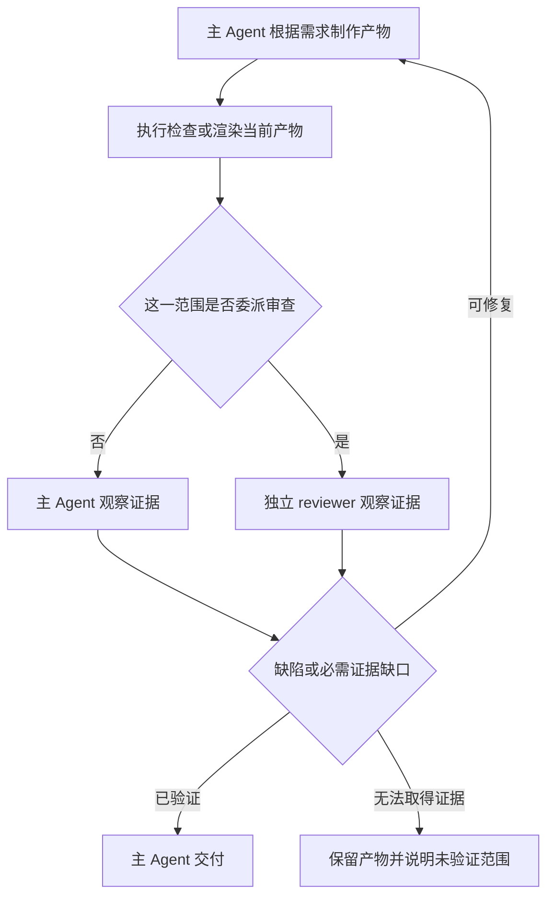

# 怎样用产物审查替代 KodaX 的 Sidecar Verifier？

结论摘要：建议退役默认的文本终止质量判官，把验证放回同一 Host 内主 Agent 的工作循环；PPT、文档等任务通过技能先渲染真实产物，再选择视觉审查，复杂代码或明确要求独立审查时复用普通子 Actor reviewer。检查发生在最终交付前；生命周期、canonical 事实、授权与客户端投影继续归原有 owner。Stop Hook 保留原有扩展用途，不增设通用验证控制面。此结论是基于源码的设计建议，尚未进行新旧方案效果比较。

## 研究范围与证据基线

- 日期：2026-10-11。KodaX 基线 `20625261f5de824fcc1e7a6a9ebffdf4ba483a45`；开始研究时工作区干净。
- ZCode 基线 `29628c9acdb81b703bbd4080c207a0e7ce5e276e`，Codex 基线 `a07c8ebd57feedc4cf5dfe854c8e9101de54186b`。外部源码仓库仅做只读研究。
- ZCode 的 PPT 插件正文来自本机第一方插件缓存 `C:/Users/ADMIN/.zcode/cli/plugins/cache/zcode-plugins-official/presentations/0.1.7/`，不包含在上述 Git commit 中。不能把缓存版本的行为概括为所有 ZCode 版本的行为。[ZCode 证据笔记](zcode-verification-mechanisms.md)
- 外部项目的事实、行号、搜索边界和未解问题分别记录在 [ZCode 证据笔记](zcode-verification-mechanisms.md) 与 [Codex 证据笔记](codex-verification-mechanisms.md)。下文“建议”均指待实施设计，不是当前 KodaX 行为。

## 统一契约面复核后的收紧（2026-10-11）

本轮补查 FEATURE_298、CLIENT_CONTRACT、SPACE_SDK_SEAMS 与当前 Host/Client 源码后，方案应进一步收紧为 **同一 Host 内主 Agent 的产物验证流程，按需调用普通子 Actor**。上一版对 verifier 内部分析较细，但没有完整核对统一 Host 的实际接线，尤其 goal gate 的范围不能泛化到产品路径。

- **执行归现有 Host。**自动 reviewer 由正在工作的主 Agent 在根 Run 内派生，复用 Actor 准入、工具上限、授权、预算和停止归属。它不是 CLI/Space 看到完成后另起的独立后台工作。公开 Client 的独立 `agents.spawn` 有单独授权与客户端归属，不能当作根 Run 子任务的等价替代；根 Stop 保留独立 turns。[FEATURE_298:219](C:/Works/GitProj/KodaX-AI/KodaX/docs/features/v0.7.97.md:219)；[SPACE_SDK_SEAMS.md:44](C:/Works/GitProj/KodaX-AI/KodaX/docs/SPACE_SDK_SEAMS.md:44)；[client-runtime-adapter.ts:215](C:/Works/GitProj/KodaX-AI/KodaX/src/client-runtime-adapter.ts:215)；[sdk-runtime.ts:9756](C:/Works/GitProj/KodaX-AI/KodaX/src/sdk-runtime.ts:9756)
- **证据沿原有权威读取。**工具请求/结果、图片引用与分支来自 canonical Session/lineage；产物检查由 Host 工具获取当前文件。observe 是有界显示投影，不是完整审查输入。Office/Browser 若由可信 Main 提供，沿现有绑定 Run 的 Host Tools bridge，不另开 renderer 执行路径或审查结果存储服务。[FEATURE_298:237](C:/Works/GitProj/KodaX-AI/KodaX/docs/features/v0.7.97.md:237)；[FEATURE_298:273](C:/Works/GitProj/KodaX-AI/KodaX/docs/features/v0.7.97.md:273)；[SPACE_SDK_SEAMS.md:30](C:/Works/GitProj/KodaX-AI/KodaX/docs/SPACE_SDK_SEAMS.md:30)；[SPACE_SDK_SEAMS.md:145](C:/Works/GitProj/KodaX-AI/KodaX/docs/SPACE_SDK_SEAMS.md:145)
- **先检查，再最终交付。**reviewer 的输出保留自身 Actor/turn 身份，主 Agent 消费检查结果后继续修复，再生成最终交付。不能让末尾 judge 回头改写已 committed 的助手消息，也不能把子报告复制成另一份 canonical 正文。[FEATURE_298:277](C:/Works/GitProj/KodaX-AI/KodaX/docs/features/v0.7.97.md:277)；[FEATURE_298:285](C:/Works/GitProj/KodaX-AI/KodaX/docs/features/v0.7.97.md:285)
- **质量与生命周期分开。**Run terminal 仍由 Host 的 Run 记录裁定；检查意见是领域证据，不是另一个终态 owner。图片读取、renderer exit 0、reviewer completed 都不证明产物过关。检查无法取得时记录未验证范围，不能合成 passed；是否继续、交付受限产物或完成 goal，由当前用户要求和 goal 领域规则决定，不由 UI 自行改状态。当前执行的 success/phase 映射与 terminal 保存也没有逐项产物质量认证含义。[client-contract.ts:760](C:/Works/GitProj/KodaX-AI/KodaX/packages/coding/src/client-contract.ts:760)；[client-runtime-adapter.ts:172](C:/Works/GitProj/KodaX-AI/KodaX/src/client-runtime-adapter.ts:172)；[sdk-runtime.ts:11055](C:/Works/GitProj/KodaX-AI/KodaX/src/sdk-runtime.ts:11055)
- **第一版不增加验证控制面。**复用 skills、Actor output、canonical 工具结果和既有 view/activity/history；当前 `review.start` 是 Host 捕获 git diff 的代码审查入口，视觉检查走现有子 Actor。去掉默认 one-shot 质量调用，不把 Stop Hook 改造成新的通用评分/证据账本；只保留已有生命周期与显式检查的扩展接口。工具调用、观察事实和质量判断分别归原有领域。[runtime-review-preparation.ts:1](C:/Works/GitProj/KodaX-AI/KodaX/src/runtime-review-preparation.ts:1)；[client-contract.ts:217](C:/Works/GitProj/KodaX-AI/KodaX/packages/coding/src/client-contract.ts:217)

**goal 接线范围修正：**下文 `sidecar-bind` 的故障 accept 映射问题是该库函数的事实，不能据此声称当前所有 Product Host Run 都会经过它。当前非测试源码中，`buildGoalRuntimeBinding` 的构造在 interactive REPL；绑定 Client 的分支走 Host，传入该 binding 的直接 `runManagedTask` 分支用于 standalone。Host 源码没有给普通执行设置 `context.goalRuntime`，缺 binding 的 goal tools 使用 disabled context。因此替换设计必须先明确 Host-owned goal 的执行接线，不能仅改旧 REPL callback 就声称全产品完成。[repl.ts:2453](C:/Works/GitProj/KodaX-AI/KodaX/packages/repl/src/interactive/repl.ts:2453)；[repl.ts:2502](C:/Works/GitProj/KodaX-AI/KodaX/packages/repl/src/interactive/repl.ts:2502)；[tool-execution-context.ts:235](C:/Works/GitProj/KodaX-AI/KodaX/packages/coding/src/agent-runtime/tool-execution-context.ts:235)

## 通用视觉覆盖与旧链退役要求（2026-10-11 用户补充）

**最终范围覆盖所有需要视觉判断的任务，PPT 仅是实例。**依据用户要求和实际可见效果触发；创建、修改和纯评审都适用，不能按文件扩展名白名单或改动行数决定是否需要视觉检查。以下是待实施的覆盖要求，不声称当前默认安装已具备全部取证工具。

| 覆盖对象 | 需要的视觉证据 |
|---|---|
| 图片、SVG、图标、海报、图表、地图、设计稿 | 实际成品；矢量/绘图代码先渲染；必要区域放大与参考对照 |
| PPT、DOCX、PDF、长报告、表格、打印页面 | 当前交付文件渲染的页/slide/sheet/range，记录实际观察范围 |
| Web、桌面/移动界面、TUI、Canvas、3D 视图 | 实际运行画面，适用视口/终端尺寸/状态/视角 |
| 导航、弹窗、加载/错误、滚动、响应式等交互 | 真实动作前后的必要状态图，与 DOM/可访问树/状态或事件结果互证 |
| 视频、GIF、动画、转场、时间变化可视化 | 最终输出的带时间戳帧图或连续序列；明确实际检查区间与抽样范围 |
| 现有产物的修改或只读评审 | 当前版本与需求/参考；修改后复查受影响页、区域、状态或时间范围 |

共同流程为：需求中的视觉验收项 → 领域技能/工具取得当前证据 → 主 Agent 或普通子 reviewer 观察 → 具体问题/未验证范围 → 修复并检查新版本 → 最终交付。独立 reviewer 按需要选择，取得任务所需视觉证据是共同责任。页面、区域、状态、视口、视角、时间范围是证据范围，不需要为每种格式建立新 runtime 或 registry。

静态截图不能证明交互和运动；抽样不能宣称全覆盖；图表/表格的计算与源数据、后端行为、音频与同步仍需要相应非视觉证据。没有取得必需证据时不能声称该项已视觉验收。当前 KodaX 有 raster Read 和实际图像 payload 身份，SDK 原生 video/file 发送尚未接通，GIF 路由也不保证完整动画观察。因此领域 render/capture/抽帧技能需要按真实能力接入，缺能力保留未验证范围，不能从设计覆盖中删去该任务类。[read.ts:340](C:/Works/GitProj/KodaX-AI/KodaX/packages/coding/src/tools/read.ts:340)；[image-serialization.ts:61](C:/Works/GitProj/KodaX-AI/KodaX/packages/llm/src/providers/image-serialization.ts:61)；[capabilities.ts:214](C:/Works/GitProj/KodaX-AI/KodaX/packages/agent/src/media/capabilities.ts:214)；[capabilities.ts:227](C:/Works/GitProj/KodaX-AI/KodaX/packages/agent/src/media/capabilities.ts:227)

**旧链必须退役干净，正常功能保留。**清理的对象是旧 verifier 的专用执行与控制语义；正常功能通过现有 Host/Actor/通知/预算接缝承接，不保留旧链作为备用分支。

| 范围 | 清理或改接要求 |
|---|---|
| 自动判断与恢复循环 | 删除旧 gate、默认一次判词、forced verdict、失败合成 accept、专用 reanimate 与 retry 文案；通用 Stop Hook 和其他真实消费者保留 |
| 任务结果与计划 | 解除旧 verdict 对 Managed 状态、完成契约、Todo 批量 failed/reset、假 Evaluator 角色/evidence 的驱动；按真实需求和检查证据逐项形成结果 |
| 提示与警告 | 停止新运行产生旧 Sidecar Verifier 标签、Verifying spinner、revise/blocked/budget-exhausted 专用消息及重复通知；实际审查进度/问题/未验证/失败沿现有 child activity、通知和历史反馈 |
| 预算与停止 | 保留真正的预算限制/扩展、取消和子任务等待；原先附着旧 verdict 的有用行为移到对应 owner，不能随桥接函数一起删除 |
| 配置与公开接口 | 清理专用 provider/model/always/log 环境映射、配置模板、命令和手册；SDK/Client 暴露面依现有兼容边界处理，不留名存实亡开关、不静默破坏旧客户端 |
| 历史会话 | 新运行不产出旧格式；保留最小集中读取兼容，能展示真实旧记录，但不恢复旧执行、不把旧通知当新输入、不重写历史 |
| 打包与验证 | 更新源码/bundle/release 审计及对应断言，不让包仍依赖已退役 prompt；保留 Worker/native/builtin 等真正分发资产 |
| 同名但不同功能 | 保留 Stall 防卡死、Auto 权限审查、通用 LLM judge 的仍在用消费者、Session 存储 sidecar、Workflow 确定性验证与真实未验证警告 |

已查到的实质耦合：`buildCompletionContractStatus` 将所有声明 criterion/UI/API/DB 项按一个旧 verdict 同时映射 ready/incomplete/blocked/missing；`applySidecarVerdictToRecorder` 还将进行中的 Todo 标 failed、发 Evaluator evidence 并触发预算扩展。这些控制副作用必须处理，不能只改 UI 文案。[role-prompts.ts:270](C:/Works/GitProj/KodaX-AI/KodaX/packages/coding/src/task-engine/_internal/managed-task/role-prompts.ts:270)；[verifier-recorder-bridge.ts:240](C:/Works/GitProj/KodaX-AI/KodaX/packages/coding/src/agent-runtime/middleware/sidecar-verifier/verifier-recorder-bridge.ts:240)

Workflow 的 `completed_unverified` / `agent_unverified` 在当前实现中来自 `evaluateVerification` 等执行检查和 enforcement，不依赖旧 sidecar 调用；其告警必须保留，相关旧注释应校正。发布 tarball audit 则确实要求旧 verifier prompt/budget 字符串，替换时必须改审计标准。[agent-adapter.ts:1139](C:/Works/GitProj/KodaX-AI/KodaX/packages/coding/src/workflows/agent-adapter.ts:1139)；[tool-execution-context.ts:432](C:/Works/GitProj/KodaX-AI/KodaX/packages/coding/src/agent-runtime/tool-execution-context.ts:432)；[audit-sidecar-tarball.mjs:13](C:/Works/GitProj/KodaX-AI/KodaX/scripts/audit-sidecar-tarball.mjs:13)；[audit-sidecar-tarball.mjs:110](C:/Works/GitProj/KodaX-AI/KodaX/scripts/audit-sidecar-tarball.mjs:110)；[release.mjs:66](C:/Works/GitProj/KodaX-AI/KodaX/scripts/release.mjs:66)

验收需要覆盖：所有视觉类别的真实取证与缺能力路径；SA 主 Agent 自查和 AMA 子 reviewer；根/子取消、预算、goal 实际接线与保存失败；Host→Client→Ink/classic/JSON/SDK 的反馈一致性；旧会话读取；新运行不调用旧 verifier、不产生旧控制字段或标签；构建、类型消费者、发布包与真实 Host 回归。这里只列验收义务，未把静态审计或未来测试计划当已通过结果。

## 1. 现有 KodaX verifier 实际在做什么

### 1.1 它是一次独立调用，不是能调查结果的 Agent

`invokeSidecarVerifier()` 把上下文渲染为字符串，交给 `invokeLlmJudge()`；后者只提供 `emit_sidecar_verdict` 一个工具并强制调用，默认输出上限 1024 tokens。没有读取文件、运行检查、浏览页面或查看图片的工具循环。[verifier.ts:312](C:/Works/GitProj/KodaX-AI/KodaX/packages/coding/src/agent-runtime/middleware/sidecar-verifier/verifier.ts:312)；[llm-judge.ts:100](C:/Works/GitProj/KodaX-AI/KodaX/packages/agent/src/runtime-middleware/llm-judge.ts:100)；[llm-judge.ts:146](C:/Works/GitProj/KodaX-AI/KodaX/packages/agent/src/runtime-middleware/llm-judge.ts:146)；[llm-judge.ts:172](C:/Works/GitProj/KodaX-AI/KodaX/packages/agent/src/runtime-middleware/llm-judge.ts:172)

它默认继承主 Agent 的 provider/model，跨模型验证需要已有的环境变量覆盖。早期 ADR 的“默认 strong family”描述与当前执行代码不同；当前事实以 resolver 为准。[verifier-provider-resolver.ts:107](C:/Works/GitProj/KodaX-AI/KodaX/packages/coding/src/agent-runtime/middleware/sidecar-verifier/verifier-provider-resolver.ts:107)；[runner-sidecar-verifier-adapter.ts:108](C:/Works/GitProj/KodaX-AI/KodaX/packages/coding/src/task-engine/runner-sidecar-verifier-adapter.ts:108)；[ADR.md:2299](C:/Works/GitProj/KodaX-AI/KodaX/docs/ADR.md:2299)

### 1.2 判定材料丢失了最重要的结果信息

| 材料 | 实际进入 verifier 的内容 | 限制 |
|---|---|---|
| 最近对话 | 最多 24 条，再把用户/助手文本与工具名、截断参数拼成文字 | 不包含 tool_result 正文；图片不会保留 |
| 工具结果 | 工具名 + `ok/error`，最多 32 项 | `ok` 只表示工具没有返回错误，不证明测试或需求通过 |
| 文件改动 | 路径 + 数值标签，最多 40 个文件 | `diffHint` 没有真实 diff 或成品内容 |
| 子任务 | 状态、摘要、有限 artifact refs | 引用不等于读取，摘要仍然是模型陈述 |
| 验证标准 | 部分 contract 字段转成文字 | 标准存在不等于执行了相应检查 |

上述边界见 [verifier-context-builder.ts:29](C:/Works/GitProj/KodaX-AI/KodaX/packages/coding/src/agent-runtime/middleware/sidecar-verifier/verifier-context-builder.ts:29)、[verifier-context-builder.ts:134](C:/Works/GitProj/KodaX-AI/KodaX/packages/coding/src/agent-runtime/middleware/sidecar-verifier/verifier-context-builder.ts:134)、[verifier-context-builder.ts:159](C:/Works/GitProj/KodaX-AI/KodaX/packages/coding/src/agent-runtime/middleware/sidecar-verifier/verifier-context-builder.ts:159)、[verifier-context-builder.ts:218](C:/Works/GitProj/KodaX-AI/KodaX/packages/coding/src/agent-runtime/middleware/sidecar-verifier/verifier-context-builder.ts:218)、[verifier-context-builder.ts:292](C:/Works/GitProj/KodaX-AI/KodaX/packages/coding/src/agent-runtime/middleware/sidecar-verifier/verifier-context-builder.ts:292) 和 [verifier-prompts.ts:179](C:/Works/GitProj/KodaX-AI/KodaX/packages/coding/src/agent-runtime/middleware/sidecar-verifier/verifier-prompts.ts:179)。

一个具体的数据语义问题：context builder 把 tracker 的值命名为 `opCount`，输出成 `N mutations`；但写入 tracker 的实际值是估计触及行数。这进一步说明 `diffHint` 不能当成真实变更证据。[verifier-context-builder.ts:139](C:/Works/GitProj/KodaX-AI/KodaX/packages/coding/src/agent-runtime/middleware/sidecar-verifier/verifier-context-builder.ts:139)；[tool-wrappers.ts:102](C:/Works/GitProj/KodaX-AI/KodaX/packages/coding/src/task-engine/_internal/managed-task/tool-wrappers.ts:102)；[tool-wrappers.ts:137](C:/Works/GitProj/KodaX-AI/KodaX/packages/coding/src/task-engine/_internal/managed-task/tool-wrappers.ts:137)

**设计推断：** verifier 即使用能力更强的模型，也不能从这些材料可靠判断 PPT 的溢出、HTML 的遮挡、图表是否画错，或者失败测试的具体原因。问题首先是证据与行动能力的边界；本次没有会话复现，因此不把这些限制声称为用户最近遇到问题的已证实根因。

### 1.3 基础设施失败与通过仍有混用

无效 verdict、缺 reason、超时、provider error、没有报告工具调用等路径返回 `accept`。普通 recorder 已通过 `verificationDegraded` 保留退化事实，不能说整个系统完全没有区分失败；但 `verifyGoalCompletion` 的映射只判断 `verdict === 'accept'`，没有检查 trace，因此在接入该函数的执行路径里，基础设施失败的默认 accept 也可能得到 `{ok:true}`。其 Product Host 接线范围见上面的修正，不作为所有产品 goal 的现状断言。[verifier.ts:219](C:/Works/GitProj/KodaX-AI/KodaX/packages/coding/src/agent-runtime/middleware/sidecar-verifier/verifier.ts:219)；[verifier.ts:295](C:/Works/GitProj/KodaX-AI/KodaX/packages/coding/src/agent-runtime/middleware/sidecar-verifier/verifier.ts:295)；[verifier-recorder-bridge.ts:81](C:/Works/GitProj/KodaX-AI/KodaX/packages/coding/src/agent-runtime/middleware/sidecar-verifier/verifier-recorder-bridge.ts:81)；[sidecar-bind.ts:82](C:/Works/GitProj/KodaX-AI/KodaX/packages/coding/src/goal/sidecar-bind.ts:82)

普通 stop gate 按 risky shell、计划、轮数、文件数、估计改动行数触发，短小可观察工作可能跳过；这衡量的是执行规模，而不是产物的可见质量。比如“小文件”本身不能证明一页 HTML 没有遮挡。[gate.ts:147](C:/Works/GitProj/KodaX-AI/KodaX/packages/coding/src/agent-runtime/middleware/sidecar-verifier/gate.ts:147)；[gate.ts:288](C:/Works/GitProj/KodaX-AI/KodaX/packages/coding/src/agent-runtime/middleware/sidecar-verifier/gate.ts:288)

## 2. 两个参考项目中值得借鉴的机制

### ZCode：PPT 的视觉 reviewer 确实看渲染后的成品

本机 `presentations/0.1.7` 的 `visual-judge` 接收用户需求与预渲染的逐页 PNG，只审查指定页面，不编辑产物、不重新渲染；每页输出 verdict 和具体证据，问题分为 Spec、Visual、Design、Unverified。它检查图片与图表、裁剪和变形、遮挡和溢出、布局，以及 PPT 投影距离的可读性。[visual-judge.md:9](C:/Users/ADMIN/.zcode/cli/plugins/cache/zcode-plugins-official/presentations/0.1.7/agents/visual-judge.md:9)；[visual-judge.md:19](C:/Users/ADMIN/.zcode/cli/plugins/cache/zcode-plugins-official/presentations/0.1.7/agents/visual-judge.md:19)；[visual-judge.md:31](C:/Users/ADMIN/.zcode/cli/plugins/cache/zcode-plugins-official/presentations/0.1.7/agents/visual-judge.md:31)

该技能将内容 QA、程序检查与视觉 QA 分开：内容查遗漏和占位符，程序查文本溢出/形状重叠，必要时渲染并做一次视觉审查。渲染链是 LibreOffice 将 PPTX 转 PDF，再由 `pdftoppm` 转逐页 PNG。[pptx/SKILL.md:152](C:/Users/ADMIN/.zcode/cli/plugins/cache/zcode-plugins-official/presentations/0.1.7/skills/pptx/SKILL.md:152)

visual-judge 的描述要求同一轮视觉验收选择 reviewer 或不可用时自查，避免主 Agent 先看一遍再重复派 reviewer。描述提到 dispatch/repair 的 system delivery protocol，但该完整协议尚未找到，不能据此确认具体修复轮数或 runtime 强制行为。[visual-judge.md:3](C:/Users/ADMIN/.zcode/cli/plugins/cache/zcode-plugins-official/presentations/0.1.7/agents/visual-judge.md:3)

**建议借鉴：**渲染成品、按页给证据、审查与修改分工、避免重复验收。模型硬编码、全局只验一次、指定软件缺失时强制安装等具体政策不适合直接搬进 KodaX core；这些是该缓存技能的政策，不是视觉验证必需条件。[visual-judge.md:5](C:/Users/ADMIN/.zcode/cli/plugins/cache/zcode-plugins-official/presentations/0.1.7/agents/visual-judge.md:5)；[pptx/SKILL.md:158](C:/Users/ADMIN/.zcode/cli/plugins/cache/zcode-plugins-official/presentations/0.1.7/skills/pptx/SKILL.md:158)；[pptx/SKILL.md:178](C:/Users/ADMIN/.zcode/cli/plugins/cache/zcode-plugins-official/presentations/0.1.7/skills/pptx/SKILL.md:178)

HTML 的浏览器工作流属于主 Agent：control-browser 默认用 DOM，视觉判断必要时截图并显式 emitImage；web-gui-tester 要求 DOM 与看过的截图互证。显式 emitImage 经 formatter 返回模型 image block，但 turn-end 自动截图只用于展示，不回灌模型。这两条链不能混为已做视觉检查。[control-browser/SKILL.md:127](C:/Works/PubProj/ZCode/apps/zcode-cli/packages/browser-use-plugin/skills/control-browser/SKILL.md:127)；[web-gui-tester/SKILL.md:98](C:/Works/PubProj/ZCode/apps/zcode-cli/packages/browser-use-plugin/skills/web-gui-tester/SKILL.md:98)；[node-repl-model-content.ts:24](C:/Works/PubProj/ZCode/apps/zcode-cli/packages/core/src/tool/handlers/node-repl-model-content.ts:24)；[browser-turn-screenshot.ts:95](C:/Works/PubProj/ZCode/apps/zcode-cli/packages/core/src/runtime/methods/browser-turn-screenshot.ts:95)

ZCode 另有 active goal 的 target-completion-verification：用当前 session model 再请求一次，只读已有历史、`tools:[]`。它可以沿历史 media policy 收到此前存在的图片，但不会自己 render、read 或操作浏览器；坏 JSON/非取消请求故障的默认结果仍是 `passed:true`。这不是建议 KodaX 原样移植的部分。[target-completion-verification.ts:133](C:/Works/PubProj/ZCode/apps/zcode-cli/packages/core/src/runtime/methods/target-completion-verification.ts:133)；[target-completion-verification.ts:338](C:/Works/PubProj/ZCode/apps/zcode-cli/packages/core/src/runtime/methods/target-completion-verification.ts:338)；[target.ts:324](C:/Works/PubProj/ZCode/apps/zcode-cli/packages/contracts/src/tools/target.ts:324)

### Codex：主循环做完成审查，独立 review 有工具循环

Codex 的 goal continuation 模板要求从 objective 推导需求，逐项查看当前文件、命令/测试输出、渲染产物和运行行为，确认检查范围覆盖要求；verifier 或 green check 只是证据，不能替代需求判断。这个实现是给主 Agent 的行为指令，不是另一个自动质量判官。[continuation.md:35](C:/Works/PubProj/Codex/codex-rs/ext/goal/templates/goals/continuation.md:35)

Codex 的 view_image 将图片转为真正的 InputImage 工具输出；显式 ReviewTask 启动独立会话，fresh history 下仍可进行多轮模型/工具调用。delegate 的 one_shot 是一次完整 turn，不是一次采样后立即判词。[view_image.rs:188](C:/Works/PubProj/Codex/codex-rs/core/src/tools/handlers/view_image.rs:188)；[review.rs:99](C:/Works/PubProj/Codex/codex-rs/core/src/tasks/review.rs:99)；[codex_delegate.rs:95](C:/Works/PubProj/Codex/codex-rs/core/src/codex_delegate.rs:95)；[codex_delegate.rs:226](C:/Works/PubProj/Codex/codex-rs/core/src/codex_delegate.rs:226)

所审查的完成路径中，update_goal 处理状态与持久化，没有独立质量模型验证；Stop Hook 可通过配置的 command/MCP 返回明确继续指令，而 Prompt/Agent hook 当前明确 unsupported。不能从存在 Stop Hook 推导出默认质量 sidecar。仓库主体是 CLI，desktop launcher 也不能证明完整的 desktop 插件和视觉工作流。[tool.rs:247](C:/Works/PubProj/Codex/codex-rs/ext/goal/src/tool.rs:247)；[turn.rs:657](C:/Works/PubProj/Codex/codex-rs/core/src/session/turn.rs:657)；[discovery.rs:637](C:/Works/PubProj/Codex/codex-rs/hooks/src/engine/discovery.rs:637)；[README.md:1](C:/Works/PubProj/Codex/README.md:1)；[app_cmd.rs:15](C:/Works/PubProj/Codex/codex-rs/cli/src/app_cmd.rs:15)

**综合推断：**两个参考项目有价值的共同点是“检查真实对象并形成证据”，而不是“多调一次模型”。ZCode 的 office 视觉 reviewer 是有用的专用分工；Codex 的主循环完成审查可以承接全局任务责任。

## 3. 推荐的替代设计

以下是方案建议；它们尚未实施，也没有宣称优于旧 verifier 的实测数据。

### 3.1 主 Agent 负责完整的验证与修复循环

主 Agent 根据用户要求决定要证明什么，并通过既有工具和技能取得证据。完成标准匹配任务：

| 任务 | 应取得的证据 | 应避免的替代证据 |
|---|---|---|
| PPT / PDF / DOCX | 内容检查、适用的结构检查、由当前文件渲染的页图及视觉判断 | 文件已生成、转换命令 exit 0 |
| HTML / UI | 真实浏览器渲染、适用视口的截图、DOM/交互结果 | 只读 HTML/CSS、只看截图文件路径 |
| 代码功能 | 实际 diff、与需求对应的测试或运行观察 | 工具调用成功、修改了若干行 |
| 调研 / 文本 | 源材料、引用与需求覆盖情况 | 为纯文本任务强制截图或多 Agent |

发现缺陷后修改，再对受影响产物重新获取证据。截图能证明可见状态，但不能证明按钮行为；单测能证明覆盖的行为，但不能证明文字没被遮挡。这个职责与现有 KodaX 的“改完检查结果” guidance 一致，新增的重点应是视觉任务与证据的具体教学。[execution-guidance.ts:17](C:/Works/GitProj/KodaX-AI/KodaX/packages/coding/src/prompts/execution-guidance.ts:17)；[Codex continuation.md:39](C:/Works/PubProj/Codex/codex-rs/ext/goal/templates/goals/continuation.md:39)

### 3.2 reviewer 按需要启动，直接接触证据

- PPT、文档等可见产物的技能可以选择专用视觉 reviewer；普通 HTML 验证可由主 Agent 自查；用户要求独立 review 或任务存在相应风险时再委派。
- 一个检查范围在同一产物版本上选一个审查者，避免主 Agent 完整视觉验收后又派同样的审查。修复后检查新版本是新验证，不受“全任务只能看一次”的限制。
- reviewer 使用精简独立上下文：原始需求、约束、当前 artifact/evidence、明确检查范围。通过既有 Actor `fork_turns: none` 和只读 capability 复用独立 review，而不是恢复 Worker→Evaluator 的固定链。
- reviewer 输出具体问题、证据及未能验证的部分；不直接修改产物、不代替主 Agent 对用户完成交付。
- 主 Agent 负责需要写临时文件的渲染；只读 reviewer 读取已生成图像。如果需要补充运行证据，由主 Agent执行受权限控制的检查。只读身份不应被误解为“任意 Bash 都没有副作用”。

可复用的现有 primitive 是 Actor spawn 的 `forkTurns`、filesystem 与工具 ceiling，以及 scoped-review 的结构化 findings/refutation；后者的 workflow 仅在需要确定执行协议时采用，不应让每次普通任务都强制启动 workflow。[agent-collaboration.ts:104](C:/Works/GitProj/KodaX-AI/KodaX/packages/coding/src/tools/agent-collaboration.ts:104)；[builtin/scoped-review.ts:119](C:/Works/GitProj/KodaX-AI/KodaX/packages/coding/src/workflows/builtin/scoped-review.ts:119)；[builtin/scoped-review.ts:144](C:/Works/GitProj/KodaX-AI/KodaX/packages/coding/src/workflows/builtin/scoped-review.ts:144)；[scoped-review.ts:48](C:/Works/GitProj/KodaX-AI/KodaX/packages/coding/src/workflows/scoped-review.ts:48)

### 3.3 Stop Hook 保留，但不再充当通用质量模型

将默认 Sidecar 的 one-shot 质量调用移出自然结束路径；停止、取消、子任务等待与保存边界继续由现有 Host/Runner 处理。任务所需的渲染、检查和证据新鲜度在主 Agent/技能工作循环解决；显式配置的确定性检查可沿已有 Stop Hook 扩展，不另建通用证据 gate。主 Agent负责需求语义、质量判断和未完成工作的处理；runtime 不尝试用文件扩展名或关键词自动判定所有任务的质量要求。

没有结构化契约时，runtime 无法证明任意自然语言目标全部实现。采用此方案必须承认这一边界：它保障可观察的契约和诚实的状态，不提供一个新的“必然正确”证书。

Agent 层已有通用 stopHook、恢复预算和取消处理，coding adapter 已在子任务活跃或通知待消费时跳过最终 verifier。这些生命期能力应保留。[runner.ts:361](C:/Works/GitProj/KodaX-AI/KodaX/packages/agent/src/primitives/runner.ts:361)；[runner.ts:1041](C:/Works/GitProj/KodaX-AI/KodaX/packages/agent/src/primitives/runner.ts:1041)；[runner-sidecar-verifier-adapter.ts:171](C:/Works/GitProj/KodaX-AI/KodaX/packages/coding/src/task-engine/runner-sidecar-verifier-adapter.ts:171)

### 3.4 最小证据约束

不必新建通用验证平台。优先沿已有 session/tool result/artifact 存储记录当前产物版本与检查证据：目标引用、版本指纹、检查范围、工具结果/截图引用，以及 passed / issues / unverified 的判断。

关键约束如下：

1. **证据绑定产物版本。**改了 PPT 后旧 PNG 的通过不能沿用；HTML 还需要覆盖所依赖的 CSS、资源和实际运行状态。截图本身的 hash 不证明截图来自当前源码。
2. **图片确实送达模型。**磁盘生成 PNG、UI 显示预览、调用 Read、模型收到图片内容是不同事实。runtime 最多证明传输和读取，不能证明模型真的理解正确。
3. **没有证据就是 unverified。**不支持 vision、渲染失败、reviewer 超时、不可读页图都不能合成 passed；允许保留并交付带明确限制的部分产物，但不能因此把仍要求视觉验收的 goal 标为 complete。
4. **不增加无界审查。**使用已有 turn/token/工具预算；只重验修复影响的范围。连续相同意见而没有新证据时停止重复审查，说明剩余问题，不能靠不断 spawn 达成“全票通过”。
5. **结果解释与传输事实分开。**renderer exit 0、Read receipt、child completed、JSON schema valid 都不是质量通过。不要提供一个可让模型凭空宣称 verified 的无证据标记。

KodaX 已有 `read` 的图片内容返回和 provider 图片序列化，不需要重建视觉 API；能力声明为 `none/image-input/full`。现有 review packet 也有 contentHash，workflow adapter 能检查 requiredReadPaths，可以借鉴其证据绑定与观察方式，但 path read 本身不应提升为视觉理解证明。[read.ts:350](C:/Works/GitProj/KodaX-AI/KodaX/packages/coding/src/tools/read.ts:350)；[openai.ts:1475](C:/Works/GitProj/KodaX-AI/KodaX/packages/llm/src/providers/openai.ts:1475)；[anthropic.ts:1467](C:/Works/GitProj/KodaX-AI/KodaX/packages/llm/src/providers/anthropic.ts:1467)；[types.ts:400](C:/Works/GitProj/KodaX-AI/KodaX/packages/llm/src/types.ts:400)；[review-packet.ts:18](C:/Works/GitProj/KodaX-AI/KodaX/packages/coding/src/workflows/review-packet.ts:18)；[agent-adapter.ts:369](C:/Works/GitProj/KodaX-AI/KodaX/packages/coding/src/workflows/agent-adapter.ts:369)

视觉检查只能选择已可用且支持图像输入的 provider；没有可用能力就报告限制或使用已配置的合适 reviewer，不硬编码某个模型，不默默跨供应商传输，不为了假设需求增加新配置。

## 4. 方案取舍

| 候选 | 解决的问题 | 代价/不足 | 建议 |
|---|---|---|---|
| 直接删掉 verifier，只靠最终回答 | 去掉额外调用 | 没有加强产物观察和可验证性 | 不足 |
| 给旧 sidecar 塞截图 | 提供部分视觉材料 | 仍是一次判词，无法调查缺口；默认每任务尾部额外成本 | 可作短期实验，非最终架构 |
| 每任务固定独立 reviewer | 让审查者有工具和独立上下文 | 简单任务重复劳动，容易变回固定链 | 不采用默认全开 |
| 同一 Host 内主循环验证 + 技能视觉审查 + 普通子 Actor reviewer | 覆盖实际产物与任务需求，复用现有 primitives 和生命周期 | 需要验证技能触发、证据新鲜度与模型差异 | 推荐 |

即使模型变强，也仍需要从实际产物和运行结果验证需求。审查模型是否独立、是否更强是后续可比较变量，不能替代实际证据。

## 5. 最小落地顺序与现有契约影响

1. **先打通跨类别共同链路。**视觉触发、证据身份、覆盖范围、当前版本与未验证语义从第一版即覆盖静态、分页、界面/交互和时序对象；领域技能分别接入 render/capture/抽帧。PPT 可作为一项测试实例，不能把最终范围收窄成 PPT 或将其它类别当作未请求的未来需求。
2. **替换默认文本质量调用。**调整 coding 的 `runner-sidecar-verifier-adapter`，保留 stopHook 与 extension `turn:complete`。goal 先确认统一 Host 的接线和所有权，再同步接入路径与 standalone 兼容路径；不能只修改旧 REPL 的 completion adapter，就声称所有产品入口已统一。
3. **用已有状态表达未验证。**复用或调整 verification contract、artifact refs、degraded/unverified 结果和 session attribution，避免新增一套 verifier registry、confidence 分数、后台 agent 常驻进程。
4. **同步产品与 SDK 契约。**当前 PRD 明确把 Sidecar 定为唯一终局质量判官，SDK profile 的 verification 也绑定 Sidecar。替换不是只删一个函数；需要新 ADR 取代相应决策，并明确停机、goal、子任务、session restore 与 profile verification 的新语义。[PRD.md:329](C:/Works/GitProj/KodaX-AI/KodaX/docs/PRD.md:329)；[PRD.md:351](C:/Works/GitProj/KodaX-AI/KodaX/docs/PRD.md:351)；[types.ts:1075](C:/Works/GitProj/KodaX-AI/KodaX/packages/coding/src/types.ts:1075)；[runner-goal-adapter.ts:195](C:/Works/GitProj/KodaX-AI/KodaX/packages/coding/src/task-engine/runner-goal-adapter.ts:195)

设计已获批准并实现；以上源码引用保留调研基线，当前代码、ADR 和 SDK 迁移文档记录退役后的实际契约。效果提升仍需受控对照，不能从机制测试推断。

## 6. 怎样验证替代设计是否值得采用

先用 Layer 1 测试可观察机制：当前图像是否送达、非视觉 provider 是否诚实退化、旧截图是否失效、reviewer 不修改产物、缺图/超时是否 unverified、子任务未结束是否阻止最终收口、goal 是否不再把 judge 故障当通过。这些问题不需要付费 LLM 调用。

“是否更会发现真实视觉缺陷、是否减少误拦截、是否保留旧方案捕获假完成的收益”需要后续受控比较，单靠源码不能回答。进入实验前依 [EVAL_GUIDELINES.md](C:/Works/GitProj/KodaX-AI/KodaX/benchmark/EVAL_GUIDELINES.md) 冻结 production prompt/tool bytes、图片输入、需求与缺陷、baseline/candidate、预算及盲化分析标准。机械指标只诊断行为，主会话读取原始证据判断净收益；不得用 exit 0 或模型自评当效果指标。本轮加入受控的当前提示词单轮探针，观察到先读图而未提前认证；受预算限制仅完成 1/4 预定场景，不执行工具，也不构成新旧质量对照。原始输出和主会话评审保存在临时目录，未宣称节省比例或质量提升。

## 未证实

- 用户最近遇到的 verifier 问题是否由假阳性、过度 revise、上下文截断、模型变化或基础设施故障引起：缺少具体会话记录。
- ZCode 当前安装版本中完整的 system delivery protocol、视觉 judge 分组策略和修复再审次数：尚未取得完整正文。
- Codex desktop 全部 PPT/HTML 视觉审查流程：本地 CLI 仓库不能覆盖该事实。
- 替代设计是否在 KodaX 各 provider 上净提升：没有进行新旧对照。

## 未解问题

- 视觉覆盖范围已经由用户明确为所有可视觉评审对象；剩余工程问题是各领域实际可用的 render/capture/抽帧接缝，不再将范围作为 PPT/HTML 二选一。
- Office 技能默认采用独立视觉 reviewer，还是由主 Agent按任务选择？建议先选一种为 tracer bullet，再以受控证据比较额外收益与成本。
- 最小机器可检查的 evidence contract 如何表示当前产物版本、必要检查与未验证范围？应从现有 verification 与 artifact 字段演进，不先造泛化平台。
- 无可用 vision provider 或 renderer 时，哪些任务可交付明确受限的产物，哪些 goal 必须继续或等待外部资源？应以用户任务和显式契约为准。
